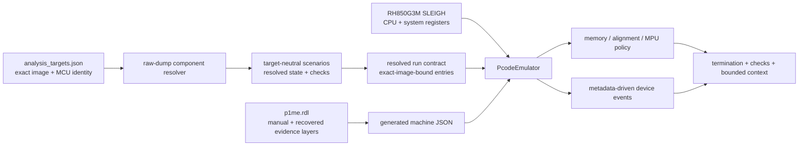

# RH850 build and execution testing

`tools/rh850` is the single interactive entry point for compilation,
exact-firmware scenarios, and observation in an installed CS+ simulator:

|Task|Command|
|---|---|
|Build or inspect the pinned GNU environment|`tools/rh850 toolchain …`|
|Regenerate or check P1M-E projections|`tools/rh850 model update` or `tools/rh850 model check`|
|Build and test payload sources, or test a retained ELF|`tools/rh850 test payload INPUT… --stop POINT --assert EXPR`|
|Test a raw or byte-pinned CodeFlash image|`tools/rh850 test codeflash IMAGE …`|
|Test scenarios against registered exact firmware|`tools/rh850 test firmware TARGET SCENARIO…`|
|Observe original firmware in the official Renesas simulator|`tools/rh850 csplus TARGET …`|
|Run retained RH850 regression suites|`tools/test rh850`|

The toolchain is GCC 16.2.0, binutils 2.46.1, and GDB 18.1 with
repository-local compiler, debugger, and simulator fixes. Builds and instruction simulation
use the same image and `v850e3v5` architecture. There is no GCC 13 compatibility
path, compiler-profile selection, backend-selection flag, or legacy command alias.
On a prepared host, verify the environment with:

```bash
tools/rh850 toolchain doctor
tools/rh850 toolchain self-test
```

`toolchain self-test` builds a full 1 MiB low-address CodeFlash section with
code at `0x0008F800`, plus a freestanding C function and assembly harness in
high RAM. It checks that all CodeFlash blocks remain distinct, crosses between
CodeFlash and RAM with positive and negative format-VI branches, executes the C
functions, and verifies deterministic RAM results. The arithmetic function computes
from a volatile local rather than a folded constant; the byte-swap function executes
`__builtin_bswap32()` on its argument. This exercises C compilation, linking,
full-image ELF loading, real low-address instruction fetch, far control flow,
native byte swapping, and basic register/stack/memory execution together.

### Native C byte swapping

Use `__builtin_bswap32(value)` in C; no inline-assembly wrapper is needed.
The pinned GCC build applies
[`gcc-v850-bswapsi2.patch`](../../tools/toolchains/v850-gcc/patches/gcc-v850-bswapsi2.patch)
to lower a register-valued 32-bit byte swap to one `BSW` instruction on V850E2
and later, including the configured RH850 `v850e3v5`. The pattern declares the
instruction's condition-code clobber. Older V850/V850E1 lowering is unchanged.

Rebuild with `tools/rh850 toolchain build` to install the
`-codegen1-unwind1` image revision. `tools/test rh850_payload` exercises
native byte swapping and bit tests, comparisons across those operations,
far-call argument/return behavior, instruction sizes, and ISA compatibility.

### Non-returning C functions

[`gcc-v850-noreturn-save-omit.patch`](../../tools/toolchains/v850-gcc/patches/gcc-v850-noreturn-save-omit.patch)
omits saves of incoming registers in ordinary `noreturn` functions only when
optimization is enabled and exceptions, unwind tables, and asynchronous unwind
tables are disabled. Locals, spills, and outgoing arguments still get their
required stack space. Returning functions and interrupt handlers retain their
normal save rules; the ABI is not weakened.

`toolchain self-test` compiles probes that require a zero-frame permanent loop,
retain space for volatile locals and a fifth argument, and preserve register
saves for returning/interrupt functions, exception/unwind modes, and `-O0`.
The signer build separately enforces its
[own-frame budgets](../WORKFLOW.md#ram-resident-tss3-build-and-kit-workflow);
an older compiler cannot silently produce the larger-stack payload.

### Native C byte bit tests

[`gcc-v850-tst1-bit-tests.patch`](../../tools/toolchains/v850-gcc/patches/gcc-v850-tst1-bit-tests.patch)
recognizes the byte-load and single-bit-test shapes produced by ordinary C.
For example, `while ((*flag & 0x10u) == 0)` can use `TST1` and a branch;
boolean results use `TST1` and `SETF`. No inline assembly or volatile bitfields
are required. Volatile accesses keep their width and read count, and a loaded
byte that is also used elsewhere keeps its load. The post-reload flag
definitions and consumers are explicit. Memory displacements are signed
16-bit values, as specified by the RH850G3M instruction set.
The payload regression executes signed-byte conditions/selections, inverse
nonvolatile byte/word bits, and low-bit volatile halfword/word access checks
across all byte values at `-Os`, `-Oz`, and `-O2`.

### Per-callee far calls

[`gcc-v850-long-call.patch`](../../tools/toolchains/v850-gcc/patches/gcc-v850-long-call.patch)
adds the function-declaration attribute `__attribute__((long_call))`.
On V850E2 and later, including RH850, an annotated direct call uses the native
six-byte `JARL disp32`; ordinary nearby calls retain four-byte `JARL disp22`.
The compiler accounts for the instruction length itself and enables the GAS
explicit-width aliases through its driver; callers need no extra assembler
flags. Older ISAs use the existing full-address indirect sequence.

Use the attribute on the distant callee declaration. Avoid applying `-mlong-calls`
to the whole translation unit. The global option still has its documented meaning:
prohibit PC-relative calls. No assembler displacement-size override or linker
relaxation is needed. The signer marks only its fixed GlobalRAM helper.

### C frame unwinding

[`gdb-v850-frame-unwind.patch`](../../tools/toolchains/v850-gcc/patches/gdb-v850-frame-unwind.patch)
uses the cached caller SP directly as a value.
It also uses FP only after the prologue establishes it, skips MOV's embedded
32-bit immediate, and ends prologue scanning at native far and register calls.
Call displacements and instructions after a call are not treated as stack setup.
This repairs the assertion reached by instruction stepping, backtraces,
and target-memory assignments in raw RAM code.

[`gcc-v850-frame-cfi.patch`](../../tools/toolchains/v850-gcc/patches/gcc-v850-frame-cfi.patch)
fixes the complementary compiled-C case: GCC must describe PREPARE register
saves and stack allocation, then the epilogue's restores and stack release.
V850 emits `.debug_frame` even when unwind tables are disabled, and GDB prefers
that information to prologue scanning. Correcting the metadata—not stripping
it—makes caller SP, return PC, and saved-register recovery trustworthy for
the covered frame shapes.

The signer build retains resident/helper ELFs with DWARF and `.debug_frame`
under metadata `debug.directory`; `debug.units` lists the ELF, disassembly,
stack reports, and compiler command for each unit. Source paths are relative
to the repository. Load the corresponding resident and helper ELFs with
GDB `add-symbol-file` when debugging the staged simulator image: their linked
VMAs already match the copied RAM code. The non-loadable debug sections never
enter the extracted payload `.text`. The helper can unwind into the resident;
the intentionally save-free, nonreturning resident has no saved incoming PC,
so its caller chain stops there.

`tools/test rh850_codeflash` exercises raw instruction stepping and memory
writes, symbolized PREPARE/FP/leaf frames, partial prologues, and real compiled-C
frames with their CFI retained. Symbol-less code without recoverable function
boundaries still cannot supply a complete backtrace.

Canary scenarios locate the built tick-wait instruction and stop after one
foreground cycle; compiler layout changes do not require repinning addresses.

## Build, execute, and verify a payload

One invocation compiles C/assembly sources, links at the addresses in the supplied
linker script, runs that exact ELF to a completion point, and checks its result:

```bash
tools/rh850 test payload path/to/entry.S path/to/payload.c \
  --linker-script path/to/payload.ld \
  --memory-region 0xFEBF0000,0x10000 \
  --stop payload_done \
  --assert '*(unsigned int *)0xFEBF0100 == 0x12345678' \
  --output-dir build/out/payload-experiment
```

Here the experiment defines `payload_done` and the result address/value.
The CLI owns breakpoint installation, execution,
and postcondition evaluation; no hand-written GDB run sequence is needed.
Without `--linker-script`, supply one already-linked ELF:

```bash
tools/rh850 test payload build/out/payload-experiment/payload.elf \
  --memory-region 0xFEBF0000,0x10000 \
  --stop payload_done \
  --assert '*(unsigned int *)0xFEBF0100 == 0x12345678'
```

Caller inputs and `--output-dir` resolve from the caller's working directory.
Source compilation preserves repository-relative includes and external source
directories' sibling headers. The compiler uses the pinned freestanding RH850
ABI; the linker script owns placement and the entry point.

Both payload and CodeFlash tests require:

- a completion symbol as seen by GDB, or a numeric address, through `--stop`
  (CodeFlash specs may supply it);
- at least one postcondition: repeatable `--assert EXPR`, or `--expect TEXT`
  for an explicit harness script's output;
- a finite execution deadline, `--timeout SECONDS` (default 30).

An entry-only stop, missing contract, failed predicate, unexpected final PC,
debugger error, missing expected output, or timeout fails the command. Loading
or inspecting an image alone is not a passing test. The timeout runs inside the
container; a host-side deadline also removes the container if its client stalls.

The payload command retains `payload.elf` and `build.txt` when building,
`output.txt`, and `report.json` with the verdict, tested ELF hash, stop, and
postconditions. Without `--output-dir`, it uses a unique directory beneath
`build/out/rh850-payload/`. A failed rebuild cannot reuse an earlier passing
verdict. Existing ELF inputs are tested in place and identified in the report.

For multi-stage harnesses, repeat `--command`/`-ex` to supply the complete GDB
execution script, including `run` or `continue`. The shared executor still
checks completion and postconditions. Scripts run as a GDB command file so a
debugger error terminates evaluation instead of falling through to a success
message. Raw debugger inspection remains available through `toolchain run`;
it has no test verdict.

`tools/test rh850` selects the retained compiler-ABI, device-model, payload,
CodeFlash, and exact-firmware suites. It does not automatically build or test
an arbitrary new experiment, and does not include signer-host tests or the
separate processor/project milestone audits.

## Specification-backed P1M-E machine

`tools/rh850 test firmware` uses Ghidra's modern `PcodeEmulator` and the
vendored RH850G3M SLEIGH language. It is separate from GNU `sim/v850`: the
p-code machine loads the exact registered CodeFlash/DataFlash identities,
rejects CodeFlash overlays, applies the SystemRDL memory/register model, and
faults on an unmapped or uninitialized read instead of supplying zero.

The canonical device source is `data/devices/p1me.rdl`.
`tools/rh850 model update` compiles it into:

- `data/generated/p1me_machine.json`, consumed by the Ghidra machine and CS+ peripheral adapter;
- `data/p1m_sfr_labels.csv`, consumed by the Ghidra device-profile scripts;
- `data/p1me_product_memory.json`, consumed by product/memory checks.

The Ghidra profile maps each generated register as typed, volatile,
non-executable data. Registers outside an existing SFR block get an exact-sized
uninitialized block from the CSV; adding a modeled register does not require a
second manually maintained list of address windows.

All three projections and their code consumers are discoverable through
`tools/artifact`. The generated machine model separates public-manual regions
and registers from `target_derived` recovered register behavior. Its product
records identify `R7F701381` and `R7F701383` individually; the runtime checks
the selected target's exact MCU identity rather than treating “P1M-E” as one
undifferentiated part.

### Architecture

The machine has one owner for each layer:

1. `ghidra/ghidra_v850/data/languages/` defines RH850G3M instruction and
   system-register semantics. Synchronization opcodes share the processor
   language's ordering-boundary userop; the machine records `SYNCE`, `SYNCM`,
   `SYNCP`, and `SYNCI` separately from their decoded instruction mnemonics.
   MPU and interrupt system registers use the G3M selector map from
   R01US0123EJ0140.
2. `data/devices/p1me.rdl` defines the P1M-E address spaces, register widths,
   access policy, reset rules, evidence class, and peripheral trigger
   relationships. Generated JSON/CSV files project this authoritative source.
   Java dispatches generated trigger/reset metadata; it does not select
   TAUJ, RSCFD, FACI, DataFlash ECC, or ICU-S behavior by register-name tables.
3. `data/analysis_targets.json` supplies exact MCU, processor language,
   CodeFlash identity, and optional DataFlash identity. It is not a capability
   whitelist.
4. Retained device-model regression scenarios supply external state, a
   target-independent structural firmware-role selector, stop addresses, checks,
   optional hash-bound RAM artifacts, and instruction-boundary external events.
   The maintained request signer does not use target-owned compatibility
   scenarios: the raw-dump resolver inventories its required roles and state,
   then materializes the same target-neutral functional scenarios for every
   registered image. `gpr_fill` states the general-register baseline once;
   `registers` contains overrides and system-register state.
   `pre_reset_memory` exercises reset retention/clearing.
5. `RunP1MEMachine.java` resolves structural roles uniquely or accepts an
   address already resolved from the exact dump-bound runtime contract. It
   records the structural or contract-derived exact-byte proof, composes the
   machine with `PcodeEmulator`, and enforces execute/read/write policy before
   each operation. One target session loads immutable images and model data
   once, then runs each scenario with fresh emulator state.
6. Reports embed the resolved run contract, external inputs, explicit termination
   reason, check results, fault provenance, and a bounded recent-PC window.
   An output-inspection fault becomes a failed check with a structured `error`
   and `actual: "unavailable"`; it never replaces the original execution fault.
   `termination_reason: "expected-fault"` describes execution independently of
   check success. A failing check still makes the report and CLI fail.
   Memory/device rows are buffered to disk during execution and streamed into
   the final JSON report; event-count checks use online per-kind counters.
   Neither execution nor report generation retains a second in-memory row
   archive. Spools are removed after the batch, including runner-error paths.
   Existing memory-access and optional instruction-trace collection limits
   are unchanged.
   The Python caller writes contracts and reports with incremental `json.dump`
   rather than assembling another whole-document string. Its capture API still
   returns the parsed report, including trace arrays, to existing consumers.

### Implementation plan and tracked status

The implementation extends Ghidra's `PcodeEmulator`; it does not add a QEMU TCG
target or a second RH850 decoder. This keeps instruction semantics in the
repository's existing SLEIGH language and makes exact registered addresses,
processor contexts, and project inventories directly reusable. GNU `sim/v850`
remains a separate execution engine for differential checks; it is not the
device-model runtime.



|Workstream|Design and invariant|Tracked status|
|---|---|---|
|CPU execution|Use the vendored RH850G3M SLEIGH language; preserve distinct decoded synchronization mnemonics while sharing one ordering-boundary p-code operation.|Implemented for the exact paths and synthetic instruction corpus. The processor fixture covers arithmetic/flags, loads/stores, branches, calls/returns, `CAXI` compare-exchange, `DI`/`EI`, system-register selectors, trap/exception return, MPU registers, and synchronization decode. This is not a claim that every G3M opcode has an independent semantic test.|
|Memory subsystem|Load registered CodeFlash/DataFlash by exact hash; map LocalRAM, GlobalRAM, SFR, and alias regions from generated data; use the target language's little-endian byte order; enforce read/write/execute policy, initialized-state provenance, alignment, and per-register access widths before side effects.|Implemented. PE1/self LocalRAM aliases are kept coherent. Unknown MMIO, illegal widths, and uninitialized reads fault.|
|Reset behavior|Initialize architectural reset registers and the SLEIGH-internal load-link monitor centrally; apply generated P1M-E reset-source rules before deciding which RAM regions to clear.|Implemented for `none`, `power-on`, `system-1-pin`, `system-1-cvm`, `system-2`, and `application-1`. A fresh machine has `ll_valid=0` and initialized `ll_addr`; scenarios need no monitor workaround.|
|Field BIST and ECM reset state|Invalidate reset-dependent opaque BIST results; distinguish executed, skipped and retained tests; apply documented ECM reset masks.|Power-on and CVM reset force BIST enable. Pin/System-2 reset honor `HWBISTEXE`; Application-1 retains results. Executed references, signatures and result words require explicit inputs; missing results fault rather than becoming successful constants. Skipped tests use documented status/FTAG values. ECM's external ERROROUT status is not synthesized from a zero-filled register.|
|ECM protection and output feedback|Commit protected writes only after `A5`, desired, inverse, desired; clear selected master/checker error latches without changing external pin state.|Malformed transactions set `ECMPS` and retain the protected value. Explicit external pin drives combine with internal output state; checker feedback requires P3_11 alternative/loopback routing and honors `PINV3.bit11`. The original clear helper accepts the inverted checker feedback programmed by boot. Active delay timers, pseudo-error routing, and dynamic output modes remain unsupported.|
|Voltage monitor|Apply the POR-only `CVMDEW` write-once latch, documented reset retention, and `CVMFC` write-one clearing.|The original startup byte store of `B4` produces `CVMDE=B7`, preserving bits1:0. Later writes are ignored until power-on reset. Comparator inputs, analog diagnostics, and voltage-triggered CPU resets are not synthesized.|
|Instruction-cache control|Use P1M-E `ICCTRL` reset `00030003` and complete the functional clear at the actual `LDSR` retirement boundary.|Strict execution has no read-count completion shortcut. It executes counted loops and preserves RAM already written before `PREPARE`; it does not initialize stack locals on function entry.|
|IPG and GlobalRAM write buffer|Model supervisor-only IPG configuration and documented GRAM buffer-control reset/writable fields.|The original application initialization runs with MPU protection enabled. Enabled user-mode IPG checks outside CodeFlash/LocalRAM fault at the unsupported boundary; group violation/SYSERR behavior is not implemented. Functional RAM writes are already visible, so buffer invalidation reads zero without an invented delay.|
|Bus guards and SEG|Apply PEG/PBG/APB/GlobalRAM protection registers, sticky locks, and initiator-specific PEID/SPID permissions.|CPU denied writes preserve device state and record SEG factors. DMA uses PEID4 and its channel SPID, not CPU MPU/IPG permissions; native guard captures retain first-error/overflow state. LocalRAM PEG grants combine by union; GlobalRAM checks every matching guard. Masked P-Bus errors do not halt the CPU; supported enabled CPU factors enter SYSERR. Unsupported read-error data is not synthesized.|
|PDMA comparator injection|Authorize `PDMA_COMP_CNTRL` writes with `PROT=10`, return protection bits as zero, and route the documented mismatch pattern to ECM source2.|Original `0x63F5E` executes unchanged, latches both ECM status banks and requests EIC8 when enabled. Bad keys preserve state; removing injection does not clear latched errors. Other checker-output selections and source2 FENMI/reset/delay-timer routing remain explicit boundaries.|
|DMAC|Model both eight-channel arbiters, independent read/write interfaces, native transfer widths and address modes, single/block transfers, reloads, chaining, zero-count wrap, request acknowledgment and errors.|Clocked checks exercise CSIH→RAM, RSENT→RAM, ADC→RAM, decrement/reload/chaining, zero-count wrap and PEID4 guard rejection. Hardware requests are independent of EIMK. One read and one write can advance per CLK_HSB edge; an accepted block retains arbitration until its boundary. DMA progresses without CPU retirement. Interconnect wait states are not modeled.|
|Peripheral scheduler|Advance named clocks to the next device deadline; commit ADC results before coincident timer/PIC triggers and peripheral state before DMA reads. Equal-boundary external inputs retain scenario order.|`clock.p_bus_cycles` advances CLK_HSB. Optional `hsb_cycles_per_instruction` declares a functional clock quantum at each retirement; there is no inferred instruction timing. ADC, TAUJ, TAUD, TSG/PIC, RSENT, DMA and FACI sequencer completion share this clock progression.|
|Interrupts|Arbitrate modeled EIC requests using EIMK, PSW.ID/NP, PMR, ISPR, priority, and channel-number tie-break; save EIPC/EIPSW/EIIC and select direct or INTBP vectors; invalidate the load-link reservation.|Original `0x62E6A` configures the documented startup channels, including CSIH sources. Byte/halfword writes preserve read-only type/reserved fields and source-controlled level requests. Edge acceptance clears EIRF; level requests remain until their source clears. Native `EIRET` releases ISPR under the documented EP/ISPC conditions. Recovered EIC292/293 storage does not establish undocumented source/reset semantics.|
|TAUJ|Model both four-channel units, CK0–CK3/BRS divisors, persistent divider phase, next-edge start loading, interval reload and IRQ/DMA requests.|Clocked checks cover start/reload and split CK3/BRS progress. The original profiling helper reads the live TAUJ1 counter. Native BRS accesses are byte-only.|
|TAUD and PIC1|Model both sixteen-channel units and selected simultaneous-start masks; keep current counters separate from next-reload CDR writes.|Original initialization and simultaneous-start helpers run unchanged. Clocked checks exercise selected-channel start, counting, reload and request delivery without starting unselected units.|
|TSG and PIC2|Model selected symmetric HT-PWM counters, compare/reload state, phase direction and internal ADC/DMA/interrupt routes.|Original phase initialization runs unchanged; a clocked full-period check observes the first valley and subcounter load. Pin feedback and unimplemented advanced modes are not supplied as successful constants.|
|ADC|Use the registered MCU's physical channels, explicit sample inputs, native result packing/read clearing, scan deadlines and IRQ/DMA requests.|Original `0x60178` initialization and internal diagnostics return after 15428 instructions without injected results. Synthetic two-channel conversion checks verify packed data, channel identity and masked completion IRQs; a DMA halfword read receives the old value before clearing both packed results. External pin samples remain explicit inputs.|
|RSENT|Model RSENT0/1 SPC operation, mode transitions, timestamps, pulse decoding/CRC, two receive buffers, status/receive interrupts and DMA read side effects.|Original `0x60C06` returns after 624 instructions without receive inputs. Synthetic pulse checks verify native timestamps/data and CRC rejection; a TAUJ→DMAC→SPCT→receive-DMAC run writes the native 24-byte record. A two-frame check preserves distinct payloads in order and the promoted buffer's DMA request. FND clears only after FRXD data reaches the bus reader. Status IRQs are level-sensitive; receive IRQs are edge-sensitive.|
|CSIH|Model enabled master transfers, direct/FIFO/dual/transmit buffers, word/halfword data aliases, pointers, EDL frame boundaries, status clearing and documented interrupt routing.|Original initialization helpers execute unchanged, including `0x623C0` with its single recessive-priority CS4 selection. Dominant/recessive arbitration applies only to broadcasts. Explicit `csih-word` inputs complete launched words; absent completions remain pending. The model does not infer serial timing or external ASIC responses. Unsupported job/data-consistency/loopback/handshake/slave-select modes, receive-only operation and FIFO timeout remain explicit boundaries.|
|RSCFD|Retain the exact registered signer response resources plus the diagnostic transmit buffer; model common receive FIFOs 3 and 5 using generated control/status/window/pointer/interrupt relationships.|Transmit events identify the buffer derived from the modeled message-RAM address. Receive inputs explicitly start **post-filter**. Mode/enable gates, payload capacity, queue depth, overflow, interrupt threshold, sticky flags, oldest-message windows, and native pointer pops are modeled. CAN1's receive level is the OR of modeled FIFO sources. Acceptance-filter execution, global RFIFOs, arbitration, bus timing, and error-state evolution are not modeled.|
|FACI / DataFlash|Preserve source images; mutate only simulated DataFlash. Model access-error clearing, keyed controls, mode transitions, clocked blank checks, 64-byte erase, 4-byte program and forced stop.|Original `0x78EC6` and `0x78E2A` issue native command sequences. Completion changes physical-cell state and, for programming, payload bytes; FRDY's rising edge requests EIC379. Regressions cover deadlines, neighboring cells, programmed-FF blankness, interruption/re-erase, and reset retention. CodeFlash mutation, suspend/resume, DMA programming, OCD emulation and partial-prefix stop recovery remain unsupported.|
|DataFlash ECC/read controls|Model error/overflow flag clearing independently; keyed `DFECCCTL`/`DFTSTCTL` fields, masked `DFERRINT`, and `EEPRDCYCL` codes3..F.|Protection keys read zero; rejected keys preserve prior fields. Codes0..2 and non-normal ECC/test-mode payload reads fault. The original `0x880` helper executes with explicit command-read bus responses; those unspecified responses are not reset constants. Read-cycle fields do not add CPU stalls; ECC generation/correction and ECM delivery are not modeled.|
|ECC protected controls|Apply each register's documented protection mask and authorized key, including DMA address-ECC's key in bits31:30 rather than15:14.|Rejected keys retain prior writable fields; protection bits read zero. This models control-register transactions, not ECC generation or correction.|
|Instruction-cache ECC status|Clear the selected data/tag bank's status, overflow flag, and captured address, using the manual's distinct command-bit and status-bit positions.|Original `0x79A` executes unchanged. Unselected banks remain intact; command reads return zero. Tag overflow's undefined reserved reset bit4 remains an explicit-input prerequisite even after clearing its functional flag. ECC error detection/correction is not synthesized.|
|RAM, CodeFlash and bus-interface ECC status|Clear selected error/capture slots and their associated overflow banks; preserve unselected state and enforce notification-register masks and access widths.|Original `0x7B6`, `0x802`, `0x8C8` and `0x96E` execute unchanged. LocalRAM has four overflow banks; GlobalRAM and CodeFlash use shared overflow flags. Status-bit positions come from the manual, not from command-bit positions. No physical error generation or simultaneous set/clear arbitration is synthesized.|
|CAN/CSIH RAM ECC configuration|Model keyed through/test-mode control and single/double-error latch clearing. Clearing a latch or entering through mode invalidates capture flags without inventing a new captured address.|Original `0xC52` exits test mode and clears the configured latches. The live `ECEMF` bit has no assumed reset value. Active RAM substitution/test generation remains unsupported.|
|Ports and noise filters|Model port configuration, masked aliases and per-pin PCR/JPCR aliases; preserve effective-bit masks, input mirrors, read-only drive fields and ECM routing.|Original `0xC9A`, `0x60CD4` and `0x60D0E` execute unchanged. PCR writes update the appropriate group and pin, including PISA where present, without creating missing JP functions. Changing a DNF clock source invalidates its activity input rather than asserting readiness. External voltages and filter timing are not synthesized.|
|Backup registers|Retain `BRAMDAT0..3` across every reset and BIST, with word-only accesses and no initial-value assumption.|Original `0xE54` consumes the validity triplet from supplied pre-reset state. Unspecified contents fault on read; a cold-start scenario must declare its backup-register inputs.|
|Operating-mode latch|Expose word-only MODE reads from explicit FLMD0/1 latch inputs; normal-mode reads suppress FLMD1 and reserved bits.|Only pin reset invalidates the existing latch, per Table5.4. Original `0x63718` returns with a supplied normal-mode latch; a new pin reset requires a new input.|
|Reset factors|Derive RESF flags from power-on, CVM, pin reset and executed BIST; retain sticky history and implement RESFC write-one clearing.|Undefined read bit6 requires an explicit input. System-2/Application-1 classes alone do not distinguish software from ECM causes; inputs resolve that ambiguity without replacing known flags. Original loads and stores exercise cause retention and clearing. This does not add CPU restart semantics to `peripheral-reset`.|
|Clock3|Use documented reset values and divider/selector status relationships for `CLKD3DIV/STAT` and `CKSC3C/S`.|Functional completion is immediate. Nonzero division sets active+synchronized; zero division sets stopped+synchronized. Actual source changes require a stopped synchronized divider; rewriting the current selector is not a source change. Original `0x61874` can stop an already-running output. No oscillator waveform or cycle-accurate synchronization is synthesized.|
|DCRA0/1|Model explicit per-unit seeds, input bit order and hardware read XOR through CIN/COUT/CTL.|DCRA1 supports Ethernet CRC32 with whole-word input. DCRA0 additionally supports the original serial driver's `CTL=22`: SAE J1850 CRC8 over each word's low byte, MSB first. Changing mode invalidates seed ownership. Undefined high CRC8 result lanes retain supplied state without algorithmic significance; other modes remain unsupported.|
|FLMD|Execute the protected `FLMDPCMD=A5`, desired/full-word inverse/desired sequence controlling `FLMDCNT.bit0`.|Bounded nominal protocol from R01UH0585EJ0120 pp2869–2874. Word-only accesses, protected commit and successful error-status clearing are modeled. Malformed sequences fault at the model boundary; hardware error timing, same-module interruption and the external FLMD0 pin level are not synthesized.|
|ICU-S|Expose recovered registers without inferring cryptography or hardware reset values. Keep the optional [startup diagnostic stub](#scripted-icu-s-startup) separate from strict command handling.|Original `0x8A4CE` completes its register-pattern initialization in 266 instructions. The opt-in response script also exercises original `0x883E8` through both diagnostic callbacks, including its deliberately negative second check. Reports identify stubbed execution; cryptographic outputs and authentication results are not supplied by this feature.|
|Integration|Expose model generation through `tools/rh850 model update` and `tools/rh850 model check`, and batched execution through `tools/rh850 test firmware`; bind identity through the existing target registry; retain one JSON report per scenario under `build/out/`.|Implemented. No parallel capability manifest, target whitelist, project lifecycle, backend selector, or legacy CLI alias exists.|
|Verification|Resolve every signer component from raw bytes and generate one functional scenario set for every registered signer target; retain target-specific fixtures only for device-model regression and negative cases.|`tools/test rh850_firmware` runs all generated signer scenarios on Camry, Crown, and both Corolla images, then the retained machine-boundary fixtures. `make verify-processor` requires this gate after the synthetic instruction fixture. GNU simulation remains an independent backend and raw-image build check.|

Progress:

- [x] Select and integrate the Ghidra p-code execution framework.
- [x] Establish strict registered-image, memory-map, alias, and fault behavior.
- [x] Generate the device specification from SystemRDL and bind reset metadata.
- [x] Implement architectural processor reset state, STAC-controlled RAM reset,
  alignment, MMIO width, and MPU enforcement.
- [x] Add deterministic peripheral scheduling and the exact TAUJ, RSCFD, FACI,
  INTC-register, and recovered ICU-S paths required by retained scenarios.
- [x] Add exact-firmware and negative regression scenarios and CLI integration.
- [x] Add manual-backed EIINT arbitration/entry/return, explicit TAUJ clock
  progression, and dump-resolved request receive-to-foreground execution across
  every registered signer target.
- [x] Execute native DataFlash erase/program sequences with clocked completion,
  payload/cell-state postconditions, and interruption/reset regressions.
- [ ] Add CodeFlash mutation and coherency only with an exact programming path
  and byte-level postconditions.
- [ ] Extend peripherals and instruction tests incrementally from failing exact
  paths; never fill undocumented behavior with permissive stubs.

The table above defines the implemented functional surface. Unknown MMIO,
illegal widths, uninitialized state, and unsupported FACI commands are hard
faults carrying PC, address, size, access kind, and evidence provenance.
A known register without a behavior model remains ordinary typed storage; it
does not acquire invented side effects.

Field-BIST examples in the manual are not device signatures. The machine does
not derive LBIST/MBIST results by copying those examples, equating reference
and signature registers, or treating software writes as completed hardware
tests. A synthetic nominal fixture states both sides explicitly; a mismatch
remains a mismatch. Reset-retention fixtures distinguish invalidated outputs
from Application-1 retention and from the manual's skipped-test state.

ECM output feedback distinguishes an initially low internal output from an
external driver holding the pin low. `ecm-pin-drive` supplies that external
condition; it does not overwrite the ECM's internal latch. In the retained
Camry startup/retry paths, the observed nominal tests require master feedback
high and checker feedback low—not both high. A released master pin can rise
after the original protected clear; an externally held-low pin remains low.

`JPPR0` and `ECMPS` retain their native eight-bit register definitions.
Explicit read widths allow the original halfword `JPPR0` and word `ECMPS`
loads to return the zero-extended register value. Isolated original-instruction
probes also observed those reads in CS+; this is simulator evidence, not a
physical-device measurement. Undeclared widths and wider writes remain faults.

Explicit `read_value` metadata models documented readback of otherwise
write-only registers, including `UCFSERSTCLR` and `UCFDERSTCLR`. It is not a
global rule that write-only or unknown registers read as zero. Separately,
`read_input` declares commands whose bus-read data is unspecified:
`DFERSTC` and `DFOVFSTC` require explicit scenario responses. The original
Camry stores/loads at `0x888/0x88A` and `0x88E/0x890` returned `1` in native
CS+ probes; both loaded values are discarded by the firmware. This is an
observed simulator response, not a silicon read-value guarantee. The strict
machine keeps that response separate from command state and invalidates it
on reset; the write still performs the documented clear.

DCRA1 models the hardware CRC peripheral through its registers.
R01UH0585EJ0120 Table33.4 (p2844) locates `CIN`, `COUT`, and `CTL` at
`FFD51000`, `FFD51004`, and `FFD51020`; Tables33.7–33.9 (pp2849–2851)
require word, word, and byte accesses respectively. The supported `CTL=00`
mode consumes input bit0 first, using the reflected `0xEDB88320` form of
the p2845 Ethernet polynomial. A `COUT` write seeds the **raw** shift state;
a read exposes that state XOR `FFFFFFFF` (Table33.8, p2850). The reset
read value is zero, corresponding to raw state `FFFFFFFF` (Table33.10,
p2852). Thus Camry `0x67060`'s final complement cancels the hardware read
XOR: its return is raw state before the usual final XOR.
It consumes only `length >> 2` words and ignores trailing bytes.

The `camry_f33_crc_*` scenarios retain actual `0x67060`, ROM-default
integrity selector `0x67090`, and composed status-repair sweep `0x670C4`
instructions. Registered descriptors at `0x2AF8C` have length at `+0`,
RAM pointer at `+4`, and the **ROM** pointer used by `0x67090` at `+8`.
Their independent expectations derive from the manual's serial feedback circuit
and immutable registered CodeFlash bytes.
Printed page numbers above equal one-based PDF page indices for this manual.

The serial frame helper `0x611FA` uses DCRA0 at `FFD50000/04/20` with
`CTL=22`: eight-bit input and the SAE J1850 polynomial `0x1D`, MSB first
(Tables33.8–33.10). It feeds seven bytes from four halfwords in big-endian
order, omitting the last low byte reserved for the check byte. A seed of
`FF` reads as `00`; the helper's final XOR cancels the hardware read XOR.
The original transmit and receive paths calculate and validate that check
byte themselves. Serial fixtures supply distinct incoming words, not an
automatic copy of the transmitted frame.

FLMD support removes a real execution boundary in Camry's application-cycle
maintenance: `0x67276` previously faulted at `0x6727E` reading `FFA00000`.
The manual identifies word registers `FLMDCNT`, `FLMDPCMD`, and `FLMDPS`
at `FFA00000/04/08`. The model retains the previous control value until the
complete protected sequence, including inversion of reserved bits, succeeds;
successful completion clears the sequence-error status. It does not replace
the firmware routine or inject register results. Native scenarios exercise
idle and protected-update paths, a stopped pre-commit prefix, access policy
and explicit model-boundary faults.

`FLMDCNT` selects an **internal pull**.
Malformed-protocol faults are not emulated `FLMDPS` errors, and do not prove
hardware retry timing. External `register-input` cannot bypass protection by
injecting FLMD control/status. CodeFlash erase/program execution remains
unsupported; DataFlash operations use their own FACI mode and enable checks.

ICU-S is intentionally marked `recovered`: the public P1M-E manual names the
block but does not publish its full register or cryptographic semantics. The
model executes the stock command-five submit and native input/output callbacks,
but supplied ICU-S data words are scenario inputs. It does not claim to derive
a provisioned key or emulate the hardware AES-CMAC implementation.
The offset20 word (`ICUSREG20`) specifically requires an explicit preload or
scheduled register input. Its two-read and one-read Camry consumers establish
bit extraction. The Ghidra profile maps the
manual's 32-byte DataFlash ECC bank and exact one-byte `EEPRDCYCL` window as
volatile; this does not grant the machine access to registers absent from its
generated definition. P1M-E hardware manual Tables31.18/31.23/31.25 and35.13
define the protected fields, notification enables and read-cycle encodings.
The Camry `0x7936E` leaf and complete `0x681F8` initializer execute against
these controls. The latter requires explicit ICU-S/access-status inputs and
forced-stop completion; its lower rejection path does not undo the earlier
RAM initialization or report an initialization result to its caller.

FACI consumes native command sequences rather than injected completion flags.
Blank checks derive `FBCSTAT`/`FPSADDR` from physical-cell state; erase and
program change that state only when their clocked operations complete.
The scenario contract below describes cell provenance and operation timing.

Forced stop follows the flash manual's Tables4.2/4.7/4.15 and §6.3.14.
`B3` shifts command history, clears the documented start-cleared error,
suspension and ready bits, and clears `CMDLK` only when `CFAE/DFAE` are clear.
With access-error flags, `ILGLERR` is temporarily clear during processing and
reasserts at completion while `CMDLK` persists. `ECRCT` clears when the
corresponding correction flags were set. Without clock progress, the original
Camry `0x78CE6` polling routine still reaches its software timeout.

`FSADDR`/`FEADDR` discard their read-only low two bits and ignore busy writes
(flash manual pp14–15). `FENTRYR` key bits read zero; writes while busy are
ignored. In the supported read/DataFlash states, a bad key clears the mode,
and a ready write while already in P/E clears it rather than re-entering
(pp21–22). CodeFlash/FWE transitions and illegal-mode error generation remain
outside this model. `FLEMU` supports only an unchanged zero write: no OCD
permission or debug emulation is inferred. FHVE registers expose bit0
(hardware manual pp2877–2878); fresh-machine reset values do not establish
reset-class retention of an existing peripheral state.

Check that all projections match the source without rewriting them:

```bash
tools/rh850 model check
```

### Raw-image signer compatibility and generated scenarios

The signer onboarding command is the compatibility entry point:

```bash
tools/toyota ram onboard path/to/CodeFlash.bin
```

The raw-byte host resolver is the compatibility gate. It reports `geometry`,
`identity`, `execution`, `boot`, `request`, `receive`, `signer_abi`, `memory`,
and `mpu` independently as `resolved`, `missing-or-ambiguous`, or `blocked`.
Any incomplete required part fails closed before compilation.

Every compatible dump builds the same 4-KiB authenticated payload. Machine-role
signatures are the staging resolver's target-discovery data. It scans the
running 1-MiB CodeFlash, writes the boot/config handoff to retained RAM, runs
the boot calls, and installs the shared resident and helper. A missing or
ambiguous role loops before the first boot call.

The command runs two exact-image GNU simulations. The
boot/context/hardware-heavy calls remain explicit overlays, but the
dump-resolved `0x10000..0x17DEF` startup shadow copy executes as exact CodeFlash.
Both runs execute the unmodified copied resident to the unmodified copied
GlobalRAM helper entry. At that boundary the runner byte-compares the copied
resident outside Corolla's intentional 36-byte state prefix, the complete
runtime config, and the GlobalRAM helper against the built artifacts. The
permanent core and P1M-E scenarios execute the helper body. For a registered
image hash, onboarding also runs the P1M-E functional suite from the contract.
A compatible unregistered image retains its candidate build and GNU result.
The P1M-E layer records `not-run-unregistered-analysis-target`; registering the
exact MCU and analyzed-project metadata enables that execution layer.

The generated suite derives every input from the resolved contract:

|Domain|Dynamic source|Checked execution|
|---|---|---|
|Startup shadow boundary|exact startup-call target whose fixed copy is `0x10000..0x17DEF` → `FEBF7C00..FEBFF9EF`|first and final words copied; a nonzero sentinel beginning at resident base `FEBFF9F0` remains unchanged|
|TAUJ0 setup|resolved mode initializer|native mode and prescaler stores|
|Freshness|resolved signer ABI|native four-bit encoder input, output, and length|
|Request publication|resolved producer, ring base, and cursors|five-word record, cursor advance, `SYNCP`|
|Request receive→foreground|resolved `0x777` rule/label, state gates, foreground, INTBP vector, and post-drain stop|TAUJ underflow, FIFO5, IRQ187 entry/`EIRET`, exact ring record, foreground consumption|
|Response transmit|structural RSCFD role plus resolved `gp`/`tp`, response ID, controller, and local resource|exact resource identifier/data/control/status and one modeled transmit event|
|Lower response wrapper|resolved lower CAN writer, online-state base, lower handle, route map, controller/resource, and response ID|helper-shaped `0x00F0`/length/ID/data-pointer PDU traverses the target wrapper and exact classic-Tx path to one modeled RSCFD transmit|
|Lower response completion|resolved native Tx-completion entry and pending software-handle slot|private handle `0x00F0` is consumed through the target dispatcher and no-op confirmation callback|
|Whole request-signer timeout|current compiled C helper artifact plus the dump-resolved runtime config, four exact software-ring records, freshness/command-five state, and lower response route|the helper consumes all four fragments, reaches the exact synchronous command-five path, packs status 2 after the bounded poll expires, and transmits the complete private `0x7A9` error response through the selected target wrapper|
|Whole request-signer completion|the same execution plus scheduled writes of supplied ICU-S output/completion state after exact submission|the exact wrapper observes completion, the helper validates done/status/length, increments its success counter, packs status 0 plus the supplied CMAC prefix, and transmits the complete response|
|Producer reload during signing|completion scenario plus an unrelated ring record published while command 5 is waiting|the helper reloads the producer after its response and consumes the arriving record before returning; whole-helper scenarios also check stack/application/callee-saved register preservation|
|ICU-S submit|structural command-five role plus dump-relative engine globals|validated command submission and in-flight state|
|ICU-S input callback|structural callback role plus dump-relative input state|four input words and acknowledgement|
|ICU-S output callback|structural callback role plus dump-relative output state|four supplied output words, cursor advance, and acknowledgement|

`tools/test rh850_firmware` requires these scenarios to pass on every
registered signer target: Camry, Crown, Corolla F, and Corolla H.

Camry's retained original-byte scenarios are one JSON object per line in
`decomp/camry-8965F3307000/oracles.jsonl`. `tools/test camry_decomp` checks the
functions whose C is listed in that tree's `matched.jsonl`.

Each report embeds the resolved run contract: unique candidate count or
dump-contract source, resolved entry, exact entry-instruction hash,
image/model identities, initial state, stop addresses, checks, termination,
and bounded recent-PC context. Scenario RAM initialization is explicit; RAM
artifacts require SHA-256 identities. Unsupported fields and attempts to
initialize registered CodeFlash/DataFlash directly are rejected.

By default, successful execution must reach a declared stop address or execute
`HALT`; exhausting `max_instructions` fails. Continuous-loop scenarios can
declare `"expected_termination": "instruction-budget"` instead. The declared
termination must match and every state/event check must still pass; a fault
or an early stop is not accepted. `"halt"` and `"stop-address"` can also be
required explicitly. Do not combine `expected_termination` with
`expected_fault`.

Machine runs wait for the Ghidra report without the bridge's default
300-second timeout. An explicit `GHIDRA_CLI_READ_TIMEOUT` overrides that wait;
`max_instructions` remains the execution bound.
The `rh850_firmware` suite has a 600-second deadline: the verified boot
milestone alone executes approximately 29 million original instructions.
The separately selected `rh850_runtime_soak` suite has a 1,800-second deadline.

Interrupt arbitration scans an index of asserted EIRF requests rather than
rereading every EIC on each instruction. Initialization, reset, device requests,
and CPU writes update that index; EIMK, priority and CPU-mask checks remain at
delivery. The native-unmask fixture covers a request captured while masked and
delivered after the original halfword store clears EIMK.

The runner checks Ghidra cancellation at instruction and scenario boundaries.
`tools/gtarget TARGET jobs` identifies a running job;
`tools/gtarget TARGET cancel JOB_ID` aborts the batch without reporting success.

Optional `hsb_cycles_per_instruction` is a positive signed-64 integer. It
advances CLK_HSB after each executed instruction; it is a declared functional
testbench ratio, not a measured CPU-cycle count. Omitting it leaves clock
progression to explicit `clock` events. CLK_HSB is 80MHz and CLK_LSB is 40MHz
for this device contract. ADC clock selection supplies its additional divider.

`dataflash_cells` supplies physical erased/programmed state separately from the
registered DataFlash payload. Each row has an aligned absolute `address`, a
positive four-byte-multiple `size`, `state: "erased"` or `"programmed"`, and
nonempty `evidence`. Ranges must not overlap or leave the target's DataFlash.
Unspecified cells stay unknown; blank checking faults if it reaches one.
A dump's byte values do not establish whether a physical word is erased.
Synthetic cell maps must identify that assumption explicitly. The registered
dump supplies initial payload observations independently of this cell map;
a modeled erase or interrupted mutation invalidates those payload observations.

Blank checking stops at the first programmed word in the selected direction.
Completion sets `FBCSTAT`; a nonblank result updates `FPSADDR`, while a blank
result retains its previous value. The functional latency model uses 100µs
per scanned 64-byte group, 30µs for a lone remaining word, and 100µs for other
partial groups (P1M-E hardware manual Table37.14). This is a deterministic
characterization-based schedule, not a recovered sequencer microarchitecture.
The same scheduler implements DataFlash `20,D0` erasure of one 64-byte block
and `E8,02`, two halfwords, `D0` programming of one four-byte word. Commands
and count are byte writes; program data are halfword writes, including values
that resemble command opcodes. Erase clears FRDY at `D0`; program clears it
at `E8`. Neither commits a mutation before its completion deadline.

Using Table37.14's hardware maxima, erase takes 10ms and program takes 1.7ms
on the declared 80MHz HSB clock with the normal 40MHz FCU notification.
Programming requires a known erased cell and normal ECC mode. Completion
makes the word physically programmed even when all four payload bytes are
`FF`. Erase establishes physical blankness without fabricating readable `FF`
bytes: erased-but-unprogrammed reads are undefined (flash manual §6.3.15;
hardware manual §35.8.2). Successful programming restores only that word's
payload validity. Neighboring cells and the source dump are unchanged.

Forced stop cancels the pending operation and completes after 20µs.
Interrupted program/erase cells become indeterminate; a complete erase is
required before blank checking or programming them again. POR and System
Reset 1/2 cancel the sequencer and reset its controls; Application Reset 1
retains them, following hardware manual TableA.1. These isolated peripheral
reset scenarios do not restart the CPU. Completed physical-cell changes
survive reset. Completion requests EIC379 on FRDY's rising edge, including
when CPU delivery is masked.

```json
"dataflash_cells": [
  {"address":"0xFF205000","size":64,"state":"erased",
   "evidence":"Explicit synthetic erased cells; not inferred from dump bytes"}
]
```

External `events` require `kind`, `evidence`, and a scheduling boundary.
Use nonnegative `after_instructions` for an absolute boundary. CSIH and RSENT
also accept their controller-relative forms below. Supported kinds:

- `clock`: positive `p_bus_cycles`; advances CLK_HSB across the modeled
  ADC, TAUJ, TAUD, TSG/PIC, RSENT, DMA and FACI deadlines, plus scripted
  ICU-S startup deadlines when enabled. The historical field name does not
  mean CLK_LSB.
- `adc-sample`: `unit` 0 or 1, physical `channel`, 12-bit integer-string `value`,
  and `boundary` (`normal`, `pull-down`, `pull-up`, or `mode1`). The sample
  becomes an input to conversion, not a result-register write. Unit 1 channel 12
  is the internal-temperature input and accepts only `normal`; external
  channels must exist on the registry-selected MCU package.
- `rsent-frame`: `unit` 0 or 1 and `pulse_samples`, a finite sequence of
  calibration, status, data and CRC falling-edge intervals in 16MHz sample
  clocks. The configured data count determines the required 4–9 intervals;
  each must be 1–131071. The receiver checks encoding and CRC itself.
  Instead of `after_instructions`, use positive `after_spc_triggers` and
  nonnegative `delay_hsb_cycles` from that unit's accepted SPC output start.
  Ordinals are scenario-wide and do not rewind on reset. Reset/abort cancels
  a pending relative response; no frame is replayed automatically. A response
  cannot overlap its trigger pulse or another frame. Reception begins at the
  supplied first calibration edge and completes only after its clocked pulses.
  Raw receive words, timestamps, completion flags and CRC verdicts are not
  accepted inputs.
- `can-rx`: `fifo`, `boundary: "post-filter"`, `can_id`, and `data_hex`;
  optional `fd`, `extended`, 12-bit `label`, and 16-bit `timestamp`.
  Classical lengths are 0–8; FD additionally permits 12/16/20/24/32/48/64
  bytes. The scenario supplies label/timestamp as accepted-message metadata.
- `csih-word`: `unit` 0–3; completes exactly one launched serial word.
  RX-enabled transfers require an unsigned 16-bit integer-string `value`;
  TX-only completions omit it. Events must follow an actual launch.
  Alternatively, omit `after_instructions` and supply positive
  `after_transmit_words` and `delay_instructions`: complete that controller's
  numbered word after the declared number of instruction boundaries from its
  actual launch. Word numbering starts at one for each controller in each
  scenario and does not rewind on peripheral reset. Duplicate relative inputs
  for one word are rejected. Reset or abort cancels a pending relative
  completion; it cannot complete a later transfer. Absolute and relative inputs
  at the same boundary retain their order in the scenario.
  Transmit-relative inputs also accept finite positive `repeat` and
  `stride_words` integers, both defaulting to one. Repetition `i` targets
  `after_transmit_words + i * stride_words`; normalization preserves source
  order and rejects overlapping ordinals or signed-64 overflow. This is a
  compact spelling of explicit inputs, not an automatic or infinite responder.
  `csih-tx` records outgoing data, chip-select mask, bit order and
  `transmit_ordinal`; `csih-frame` records a completed EDL frame. These are
  explicit functional wire transactions, not a clock-derived latency or a
  peripheral-peer model. For example, this supplies the first received word:

  ```json
  {"kind":"csih-word","unit":1,"after_transmit_words":1,"delay_instructions":128,
   "value":"0x6400","evidence":"Explicit synthetic wire input; functional latency"}
  ```
- `interrupt`: `channel`; requests a modeled EIC source. Unknown/reserved
  channels fail closed.
- `memory-write`: 32-bit `address` and non-empty `data_hex`; supplies a
  deterministic asynchronous write to modeled writable RAM. It is explicit
  scenario state and does not invoke CPU-store callbacks or imply hardware
  timing.
- `register-input`: a generated device `register` name and unsigned integer-string
  `value` (at most32 bits and fitting that register's width). Software-readable
  registers accept external device state without CPU-store callbacks or command
  triggers; reports identify it as `external-register-input`. Write-only commands
  accept an input only when generated `read_input` metadata explicitly declares
  an unspecified bus response. Such inputs are reported as
  `external-register-read-response`, do not alter command storage or execute the
  command, and expire on reset. CPU-register names, other write-only commands,
  and oversized values are rejected. Ordinary `memory-write` remains RAM-only.
  Modeled DMA, ADC, timer/PIC, RSENT and FACI state must instead evolve through
  native commands and the corresponding clock/input events.
- `ecm-pin-drive`: `pin: "ERROROUT"` or `"ERROROUT_C"` and
  `drive: "released"` or `"low"`; supplies external digital drive while retaining
  the ECM's own output assertion and checker port-routing gates.
- `peripheral-reset`: `reset_class` selects a supported reset source for an
  isolated retention scenario. It reapplies peripheral and RAM reset rules,
  including STAC-controlled RAM initialization. It **does not restart the
  CPU** or represent a complete ECU reset.

For `RESF`, a `register-input` supplies the complete observed word but may
resolve only currently unknown bits. It cannot clear or invent already-derived
flags. For example, after power-on with field BIST enabled, `0x403` supplies
zero for undefined read bit6; the power-on, pin-reset and BIST flags already
come from the controller. An ambiguous System-2 or Application-1 reset also
requires the corresponding software/ECM source flag. `RESFC` clears only
implemented flags and does not determine undefined bit6.

Stop addresses are terminal: events scheduled after reaching a stop are not
executed. Unsupported modes and missing state remain faults.

The `memory-equal` check compares `size` positive bytes at `address` with bytes
at `source_address` in the same final machine state. It reports `equal` or
`different` while keeping the compared bytes out of the report. Use this to check a destination against
registered DataFlash without copying captured payload/key material into a
golden fixture. Like ordinary memory checks, read failures produce check errors
and leave the comparison unsuccessful.

The functional profile establishes instruction, register, memory, and
modeled-device behavior. The startup-shadow scenario executes the exact CPU copy
loop and ordinary RAM writes, but neither machine backend models instruction
cache contents or proves the hardware publication effect of dummy-read /
`SYNCP` / `SYNCI`. The request event begins after acceptance filtering; the
resolver proves the exact stock rule and native downstream path but the machine
does not execute RSCFD acceptance filters. ICU-S output/completion words may be
supplied as scheduled scenario state; they are not provisioned-key
cryptography. Register rules tagged `manual` come from the public Renesas
manuals; rules tagged `recovered` remain exact-firmware-derived.

### Scripted ICU-S startup

`icus_startup_stub` is an optional scenario member for the two selector-free
diagnostic commands `0x7000` and `0x7100`. Without it, strict handling of these
unimplemented hardware commands is unchanged. It does not accept cryptographic
commands, output blocks, keys, or authentication verdicts.

The reconstructed Camry startup sequence (`0x883E8`) loads its parameter block,
runs the first diagnostic, then runs a negative diagnostic. Its completion
callback (`0x8ADA8`) expects no encoded error for the first and `0x100C` for the
second. The following script supplies those **caller-expected outcomes**:

```json
"icus_startup_stub": {
  "evidence": "Driver-contract bench assumption, not captured hardware; chosen test latency",
  "responses": [
    {"command":"0x7000","error_bits":"0x0","completion_hsb_cycles":1024},
    {"command":"0x7100","error_bits":"0x800","completion_hsb_cycles":1024}
  ]
}
```

The script is finite and ordered. Each accepted command consumes one response,
enters busy state, and completes only after the declared positive HSB-cycle
delay. `error_bits` is an integer string restricted to the recovered low
twelve-bit error field. `0x800` is bit11, which the original encoder converts
to `0x100C`; the hardware meaning of that bit is not asserted.
There is no default successful reply, measured-latency claim, or completion
based on the number of status reads.

The stub assumes initially idle busy/status/IRQ words and a clear error word.
A completion makes the original polling driver eligible to invoke its callback.
The callback's acknowledgement clears completion but preserves the error word
for the subsequent native read. An external peripheral reset cancels a pending
reply and returns this bench peer to its declared idle state; it does not rewind
consumed responses. This is the stub's reset contract, not a recovered ICU-S
reset specification. Overlapping, out-of-order or exhausted scripted commands
produce `icus-startup-stub-mismatch`, rather than silently continuing.

Reports embed the script in `resolved_run_contract`, set `stubbed_execution`,
and record `icus-startup-stub-*` reset/start/completion/acknowledgement/cancellation
events with HSB and instruction coordinates. Passing non-fault runs use
`verified-stubbed-execution`; expected-fault cases retain
`verified-expected-fault` with the stub marker. No CPU instructions or firmware
branches are skipped. This stub does not model ICU-S interrupts or cryptography.

Run the original three-step routine against the declared peer:

```sh
tools/rh850 test firmware camry-8965F3307000 \
  tests/fixtures/rh850/machine/camry-8965F3307000/original-icus-startup-scripted-diagnostics.json \
  --output-dir build/out/rh850-machine/icus-startup
```

Retained regressions also exercise both diagnostic failure paths, the original
2500-iteration poll timeout, finite-script exhaustion, reset cancellation, and
the unchanged strict-mode rejection. No independent hardware trace of these
diagnostic responses was found in the supplied observations.

### DMA master rewrite assumption

`dma_master_rewrite_assumption` is an optional, nonempty evidence string. It
permits an enabled channel's `DMxCM` register to be rewritten **only with its
existing value**. Camry's original periodic routine at `0x60A10` performs these
rewrites; §7.8.1 of R01UH0585EJ0120 nevertheless prohibits writes while `DTE=1`
and does not guarantee their hardware behavior. This option explicitly assumes
that an identical rewrite preserves state; it is not a relaxation justified by
that manual or by a hardware capture.

The default still rejects the write. Even with the option, a changed master
identity remains rejected, channel enables are not cleared, access permissions
remain enforced, and DMA scheduling is unchanged. Each accepted rewrite emits
`dma-master-rewrite-assumption` with register, value, PC, instruction count and
the supplied evidence. Reports retain the assumption in `resolved_run_contract`
and mark the run as stubbed, using the same result conventions as the startup
stub above.

```json
"dma_master_rewrite_assumption": "Bench assumption: identical periodic master rewrites preserve state; not hardware-verified"
```

## CodeFlash simulation

`tools/rh850 test codeflash` executes a raw CodeFlash image at its real
addresses, with optional RAM residents loaded at exact addresses:

```bash
tools/rh850 test codeflash path/to/CodeFlash.bin \
  --entry 0x00012340 \
  --load 0xFEBF0000=path/to/resident.bin \
  --memory-region 0xFEBE0000,0x20000 \
  --stop 0xFEBF0080 \
  --assert '*(unsigned int *)0xFEBF0100 == 0x12345678'
```

This tests an explicitly bounded experiment on a newly acquired binary: no
registered-target knowledge is required, and entry may point into CodeFlash
or any `--load` range. The stop and result in the example describe the loaded
experimental resident. As with payload tests, a completion point and checked
postcondition are mandatory; there is no default inspection-as-success path.
`--output-dir` retains the linked ELF, modeled image, and output for debugging.

### Specs

Once a target's execution contract is understood, capture it as a spec and
everything becomes byte-pinned:

```bash
tools/rh850 test codeflash firmware/camry-8965F3307000/CodeFlash.bin \
  --spec tests/fixtures/rh850/camry_f33_gate2_codeflash_sim.json \
  --expect 'GATE2_RESULT=0x222 FRESHNESS_ARG=1 ROOT_BOOL=1'
```

A spec (see the JSON files in `tests/fixtures/rh850/`) pins the image size and
SHA-256, an assembly harness (stock GP/TP/SP context, call-boundary stubs),
RAM-load pockets (address + maximum size), memory regions, an explicit `stop`,
one ordered GDB script, and instruction overlays. Each overlay replaces bytes at a known
address — but only after verifying the original bytes still match, so any
image drift aborts before execution. The harness models privileged
boot/context installation and hardware-heavy callees; everything else (stock
startup JARLs, RAM-clear, scheduler, foreground) runs unmodified at its
original address.

The TSS3 signer does not use a Camry-only checked-in spec. The dump onboarding
workflow generates byte-pinned overlays and a GP/TP/SP harness from each
resolved firmware contract, then executes the same universal payload against
that exact CodeFlash:

```bash
tools/toyota ram onboard path/to/CodeFlash.bin
```

Its two clean simulator processes share one linked ELF: one reaches the
GlobalRAM helper through the complete post-foreground fallback, the other
through the timer-bounded idle branch. Boot, context, startup-final, and
hardware-heavy foreground callees are explicit generated overlays; their
preimages remain bound to the supplied dump.

Both paths also check that the resident reaches helper entry with the SP
installed by the context overlay: the C resident must retain no stack frame.
Mid-run changes use ordinary `set {type}` memory assignments; the former
binary-file `restore` workaround is no longer needed. See
[C frame unwinding](#c-frame-unwinding) for the compiler and debugger repairs.

One gate runs every modeled scenario — generic synthetic image, the F33
Gate-2 stock/root-only/stage-2/stage-3 differential, the F33 and Corolla
H/F RAM residents, and the universal signer fallback/idle paths on every
registered Camry, Crown, and Corolla H/F CodeFlash:

```bash
tools/test rh850_codeflash
```

These executions found a real pre-deployment defect: a non-inlined `call0`
helper linked at VMA zero became an absolute call to `0x46` after loading the
resident at `0xFEBF0000`. Both the F33 and Corolla canaries/proxies now
inline target calls.

### Proof boundary

A passing simulation proves the executed CPU instructions, exact low user-area
CodeFlash preimages, call targets, RAM placement, and modeled state transitions
— nothing else. GNU `sim/v850` does **not** model P1M-E LocalRAM aliases,
instruction-cache state or the RAM publication effect of dummy-read /
`SYNCP` / `SYNCI`, MPU/IPG access checks, ECC, reset-class RAM initialization,
interrupts, peripherals, watchdogs, command-5 hardware permission, or timing.
It also does not prove `MCTL.MA=0` misalignment exceptions unless a specific
CPU model implements and exercises them. MMIO-heavy payloads need explicit
register models; do not treat simulator success as evidence for RSCFD, ICU-S,
FACI, ECM, or timing behavior. An isolated bench or in-vehicle canary remains
required per target.

### Simulator fixes

Upstream GNU `sim/v850` has a long-standing format-VI 32-bit-immediate decoder
bug affecting `jarl32`/`jr32`/`jmp32` (the `imm32` cache in `v850.igen` used a
relational `<` where a shift was intended, and assembled the encoded halfwords
in the wrong order; still present on upstream master). The pinned simulator
also lacked the four-byte RH850E3 `loop reg1, disp16` instruction: it shares
its first halfword with six-byte `jmp32`, but has **bit 16 set** rather than
clear. On exact Camry `8965F3307000`, the original `e1 06 09 00` at `0x52B8`
therefore incorrectly consumed the following instruction and jumped to
`0x007F000C`, rather than decrementing `r1` and branching to `0x52B0`.
The repository toolchain applies four simulator patches:

- `binutils-v850-sim-imm32.patch` fixes format-VI immediate word assembly;
- `binutils-v850-sim-codeflash-map.patch` replaces the legacy 32 KiB mirrored
  backing store for `0x00000000..0x000FFFFF` with a complete 1 MiB store —
  without it every `0x8000`-byte block overwrites the previous alias;
- `binutils-v850-sim-loop.patch` disambiguates the six-byte `jmp32` (bit 16
  zero) from four-byte RH850E3 `loop` (bit 16 one), and implements LOOP's
  unsigned backward displacement, decrement, and `ADD(-1)` condition flags;
- `binutils-v850-sim-sync.patch` decodes `SYNCP` and `SYNCI` as completed
  synchronization operations. GNU sim has no cache state to update.

`tools/rh850 toolchain self-test` exercises the prior long branch/CodeFlash
cases, the corrected taken/fallthrough LOOP cases (including Z/CY flags), the
non-LOOP six-byte JMP32 decoder, and both synchronization instructions. The
existing `tools/test rh850_codeflash` suite additionally executes the
**original, unmodified** Camry boot parser
`0x52A6` through LOOP at `0x52B8`, checks its big-endian result, then follows
boot SID `0x34` from `0x5D68` to the locked SecurityAccess reject arm at
`0x5F04`, with the requested RAM address and size verified.

### Known simulator gaps (harness controls)

Two further gaps affect the **application** (not boot) surface on exact Camry
`8965F3307000`:

- **`stsr PMR` raises SIGILL** (`eb .. 40 10`, e.g. `0x6A45E` and
  `priority_mask_raise @ 0x701C4`), while `ldsr` with the same register field
  decodes without trapping. The isolated single-threaded CanTp and Dcm trials
  replace the affected PMR save/restore thunks after `load`; those trials do
  not simulate interrupts. A GDB target-endian
  `set {unsigned short}ADDR = 0x007f` writes instruction bytes `7f 00`
  (`jmp [lp]`); `0x7f00` is byte-swapped and is not the intended return.
- **TP-relative addressing decodes as plain `r5`.** `get_cantp_configuration_
  pointer_7a32e` is `movea -0x118c, tp, r10`, and the whole CanTp/Dcm/PduR
  family derives config/table pointers from TP. Binutils renders the operand
  `r5`, and the simulator computes `GR[5] + imm`. Priming `$r5` therefore
  stands in for TP; the hardware value is `0x23DFC` (so `tp - 0x118C` =
  `0x22C70`, `F33CanTpConfiguration`; `TP-0x236C` → filter table `0x21FA0`,
  `TP-0x236C+4` → the `0x79DB0` CanTp callback). `$tp` itself accepts GDB
  writes but the value does not reach the executed instruction.
- **System-register state does not survive stops reliably and codeflash
  bytes patched via `set {unsigned short}` persist**, so per-frame register
  re-priming (including `$r5`) is required whenever a breakpoint intervened.

## Rebuilding the GNU setup

`tools/toolchains/v850-gcc/Dockerfile` owns the Ubuntu digest and GCC,
binutils, and GDB source revisions. Each cloned release is checked against its
pinned commit. `tools/rh850` owns the single image tag used by every command.

Build and verify it with:

```bash
tools/rh850 toolchain build
tools/rh850 toolchain doctor
tools/rh850 toolchain self-test
```

`tools/rh850 toolchain image` prints the canonical tag without requiring Docker.
Generic callers should use the wrapper rather than copying version strings
into argument defaults. `--toolchain`, `--image`, and `build-compat-image` are
not supported; `RH850_TOOLCHAIN_IMAGE` no longer changes image selection.

Historical compiler outputs and audit records remain immutable evidence.
Current ECU payload builders all use the single supported pinned toolchain
through `tools/rh850`; builder CLIs do not accept
an image or compiler override. A compiler upgrade can change bytes without
changing behavior, so field-qualified historical binaries remain separate from
newly built artifacts until the new artifacts receive their own qualification.

`tools/rh850 toolchain run ...` is the escape hatch for invoking any
`v850-elf-*` program with the repository mounted at `/src`; for example,
`tools/rh850 toolchain run v850-elf-objdump -d build/out/example.elf`.
Builders use `tools/rh850 toolchain run --work-dir PATH ...` when they need a
scratch directory mounted at `/out`; dependent compile, conversion, and
inspection commands are batched into one container invocation.
`tools/rh850_toolchain.py` provides the canonical command construction and
provenance to Python callers.

## Official Renesas options

Renesas also ships two useful but separate products:

1. **[CS+ RH850 instruction simulator](https://www.renesas.com/en/software-tool/simulator-cs-rh850-family).**
   It models RH850 CPU instructions, registers, and address space. It is not a
   P1M-E peripheral emulator.
2. **[Cycle-Accurate Simulator for RH850](https://www.renesas.com/en/software-tool/cycle-accurate-simulator-rh850).**
   The supported-series table includes P1M-E, but Renesas explicitly requires
   confirmation of the exact device: not every device in a listed series is
   covered. Cycle accuracy requires a per-series information-file installer
   and a node-locked license. The public
   [C1x V1.04.00 package](https://www.renesas.com/us/en/document/rln/cs-cycle-accurate-simulator-rh850c1x-v10400-release-note)
   supplies profiles for R7F701270, R7F701275, and R7F701278—not the Camry's
   R7F701381. Request the P1M-E/R7F701381 profile and license from Renesas;
   the website's series-level support claim does not make the C1x installer
   a P1M-E profile. The add-on models selected peripherals, not a complete EPS.
   Renesas advertises executable-file support for CC-RH and GHS.
   GNU `v850-elf` support is unadvertised, so this is not a drop-in executor
   for our deployment ELF.

The current **CC-RH V2.08.00** compiler has a Linux x86-64 distribution in
addition to Windows; Renesas publishes it through the
[compiler installation guide](https://www.renesas.com/en/software-tool/compiler-installation-guide).
CC-RH serves only as an external reference tool.
`tools/rh850` selects the supported GNU build path.

The official CS+ simulator is useful as an independent CPU implementation,
especially for ISA edge cases and CC-RH differential tests. Its documented
[command-line Python interface](https://tool-support.renesas.com/autoupdate/support/onlinehelp/csp/V8.16.00/CS+.chm/po-ProjectOperation.chm/Output/po_function_command-nav-2.html)
can also load a raw CodeFlash image with
`debugger.Download.Binary(path, base, False)`; no compiler conversion or
firmware patch is required. Select `DebugTool.Simulator` explicitly before
connecting. A successful download or process exit is not execution proof:
check the resulting PC/registers and read back the image.

### CS+ V8.16 under CrossOver

The Windows simulator was exercised on Apple Silicon with Rosetta 2 and
CrossOver 26.3 in a separate `build/cache/renesas-csplus-81600` bottle.
This is an observed compatibility configuration, not a Renesas-supported
macOS platform. The required components were:

- CS+ for CC V8.16, its RH850 device information, CC-RH V2.08, and the
  Renesas License Manager, installed from the supplied vendor packages.
- Native Microsoft .NET Framework, not Wine Mono. In this bottle, remove
  Wine Mono through its uninstaller, install .NET 4.0 using the CrossOver
  Windows XP installer compatibility setting, then upgrade to .NET 4.8
  using the Windows 7 setting. Launch CS+ with `--dll mscoree=n`.
  Installing 4.8 alone left the native CLR loader unavailable.
- Microsoft Visual C++ 2015–2022 redistributables for **both x86 and x64**.
  The bundle supplied x86; the x64 host additionally needed Microsoft's x64
  redistributable for `AssembleRh850.dll` and its native dependencies.

The headless executable `64CS.exe` accepts `/lp PythonConsole /ps SCRIPT PROJECT`,
where `SCRIPT` and `PROJECT` are Windows paths. The embedded scripting runtime
is IronPython 2.7.11. For numeric breakpoints, assign an integer to
`BreakCondition.Address`: a string such as `"0x2CA"` was interpreted as a
symbol and rejected. Check the returned event number before execution.
The repository driver uses nonblocking `GoOption.Normal` and a host deadline;
`GoOption.WaitBreak` can wait indefinitely. Use a debug-only project for the
exact device, not a different RH850 device's sample project.

Run the repository-owned driver against an explicitly registered target:

```sh
tools/rh850 csplus camry-8965F3307000 --seconds 30 \
  --output-dir build/out/rh850-csplus/camry-reset
```

`--bottle PATH` selects another already-installed CrossOver bottle. The
default is `build/cache/renesas-csplus-81600`. Each invocation creates an
exact-device debug-only project with a unique filename, selects the simulator, loads the registered
CodeFlash and DataFlash, and checks the complete simulator readbacks against
their registered sizes and SHA-256 hashes **before execution**. It resets
the CPU, removes all address breakpoints, and runs freely. `--seconds` is a
host-time observation interval, not simulated time or a firmware completion
criterion. At its end, the driver pauses a still-running CPU and records that
pause explicitly.

The output directory retains `report.json`, `console.log`, `coverage.csrcv`,
the generated IronPython driver and input contract, the CS+ project, and both
flash readbacks. Coverage is cleared before execution and exported through the
native CS+ coverage API. The report includes exception and MPU registers;
the CLI prints paths to the report, console log, and coverage file.
Without `--output-dir`, each run gets a unique directory below
`build/out/rh850-csplus/TARGET/`. `status: observed` means that execution was
observed, **not** that firmware boot or a lifecycle test passed.

On exact Camry `camry-8965F3307000`, unrestricted runs with both original
images reached the firmware's own infinite branch at `0x744`. This was
observed both before and after installing the original C1x V1.04.00 add-on.
A separate diagnostic run stopped at the already-observed failing check
at `0x392`: actual CPU loads of `BSEQ0ST` (`0xFFCDA030`) and `BSEQ0STB`
(`0xFFCDA034`) had produced zero. The firmware compares them against `2`
and `1`, respectively, and branches to its failure path at `0x6B0`.
No firmware bytes, branch outcomes, or peripheral inputs were patched.

The P1M-E hardware manual, R01UH0585EJ0120 §31.6.3, specifies `2` and `1`
after successful field BIST, equal reference/signature pairs, and an ECM
post-BIST status indication. The registers' pre-BIST reset table is not
the CPU-visible state after completed power-on BIST. A correct environment
must model that transition rather than simply copying reset constants.

The installed instruction simulator's
[documented restrictions](https://tool-support.renesas.com/autoupdate/support/onlinehelp/csp/V8.16.00/CS+.chm/DebugTool-RH850.chm/Output/db_kinou_config29.html)
exclude peripheral functions and option bytes. Its
[connection-settings documentation](https://tool-support.renesas.com/autoupdate/support/onlinehelp/csp/V8.16.00/CS+.chm/DebugTool-RH850.chm/Output/db_T_ConnectSettings.html)
also marks the simulator configuration-file category as always disabled.
Direct attempts to back the BIST window through the documented `Map.Set`
types failed with `E1710125`; `Memory.Write` rejected the address.
`Download.Binary` returned success for a PBUS write, but its corresponding
readback failed with `E0617018`. RAM reads/writes succeeded in the same
session. Thus a downloader's success result alone is not evidence that an
I/O register has usable backing storage. In particular, `Memory.Read`
returned numeric zero while also reporting `E1710215`; those debugger
returns are not valid register observations. The CPU register values at
the comparison above establish the failing execution path independently.

Named IOR access is a **different, working interface**:
[`debugger.GetIORList()`](https://tool-support.renesas.com/autoupdate/support/onlinehelp/csp/V8.16.00/CS+.chm/PythonConsole.chm/Output/py_Python_function72.html)
enumerates the exact device's names, and
[`debugger.Register.SetValue()`](https://tool-support.renesas.com/autoupdate/support/onlinehelp/csp/V8.16.00/CS+.chm/PythonConsole.chm/Output/py_Python_function105.html)
writes their simulated values. Writing `SYS.BSEQ0ST=2` through this interface
was verified by the original firmware's subsequent CPU load, not just a
debugger readback. The driver exposes this supported facility as repeatable
`--ior NAME=VALUE` arguments. It rejects names absent from the device's IOR
inventory, applies inputs after reset, verifies their named readbacks, and
records every supplied value in the report. No inputs are applied by default.

This diagnostic run supplies four **explicit partial BIST-completion
inputs**, not a complete power-on environment:

```sh
tools/rh850 csplus camry-8965F3307000 --seconds 5 \
  --ior SYS.BSEQ0ST=2 --ior SYS.BSEQ0STB=1 \
  --ior ECMM.ESSTR2=0x08000000 --ior ECMC.ESSTR2=0x08000000 \
  --output-dir build/out/rh850-csplus/camry-explicit-bist-inputs
```

With the original flash images, that run advances to the `0x7D6–0x7EA`
polling loop. The firmware writes `0x4000` to
`ECCCPU1.LRECCCTL_PE1` (`0xFFC65400`) and reads back `0x4000`.
R01UH0585EJ0120 table 31.28 specifies that `PROT[1:0]` (bits 15–14)
authorize the write but always read as zero. The firmware therefore waits
for zero. This is a demonstrated missing register behavior, not an address
breakpoint or a missing initial value; another one-time initialization
cannot correct a value that firmware repeatedly rewrites.

Add `--p1me-peripherals` to enable the native adapter's implemented SystemRDL
protocols: protected ECC controls, selected error/overflow/capture clearing,
notification masks, CAN/CSIH ECC configuration, port aliases, disabled noise-filter
configuration, clock3, DCRA0 CRC8, DCRA1 CRC32, and declared constant readbacks. Trigger support
is explicit; new strict-machine behaviors do not automatically become native
callbacks. Model-derived clock/CRC/port state and constant readbacks cannot be
overridden with `--ior`. Undefined reset bits and command-read data retain their
native simulator responses, identified as such in the report.

```sh
tools/rh850 csplus camry-8965F3307000 --seconds 600 --p1me-peripherals \
  --ior SYS.LBISTREF1=0x12345 --ior SYS.LBISTSIG1=0x12345 \
  --ior SYS.LBISTREF2=0x6789A --ior SYS.LBISTSIG2=0x6789A \
  --ior SYS.MBISTREF=0xBCDEF --ior SYS.MBISTSIG=0xBCDEF \
  --ior SYS.MBISTFTAGL=0 --ior SYS.MBISTFTAGH=0 \
  --ior SYS.BSEQ0CTL=1 --ior SYS.BSEQ0ST=2 --ior SYS.BSEQ0STB=1 \
  --ior ECMM.ESSTR2=0x08000000 --ior ECMC.ESSTR2=0x08000000 \
  --ior PORTJ.JPPR0=0 \
  --output-dir build/out/rh850-csplus/camry-peripherals
```

The reference/signature pairs in this example are declared synthetic nominal
inputs, not manufacturer signatures or a captured vehicle boot.

The adapter uses peripheral access events and native trace data, not
firmware-address cutoffs. The simulator permits only
[64 enabled events](https://tool-support.renesas.com/autoupdate/support/onlinehelp/csp/V8.16.00/CS+.chm/DebugTool-RH850.chm/Output/db_kinou_func56.html);
the adapter covers the modeled controls with
[inclusive address-range events](https://tool-support.renesas.com/autoupdate/support/onlinehelp/csp/V8.16.00/CS+.chm/DebugTool-RH850.chm/Output/db_D_Detail_AccessEvents.html)
rather than one event per register or byte lane. Because Python's
`BreakCondition` omits range properties, the V8.16 binding uses the existing
CLR event-detail commit path and verifies the committed range, access type,
access size, and stop action. It does not patch the simulator or raise its
resource limit. IOR binding indexes native addresses once and still rejects
ambiguous names.

Writes apply authorization and writable-mask rules before the next CPU
instruction. The original ECC, port, serial CRC8 and clock-stop helpers were
exercised through their actual return instructions, with native IOR readbacks
checked after the modeled transactions. Key location and legal byte lanes come
from each register's metadata; DMA address-ECC differs from the usual low-word
key. Clock3 follows functional transitions, including idempotent source writes,
rather than pinning its status to a successful value.

DCRA input is processed in trace batches, including repeated identical
words. CS+ can retire a store when its trace buffer fills without retaining
the final data record. The adapter checks the retained instruction and
post-instruction PC, then recovers that write from the source register and
matching IOR latch. Reports count these completed trace-tail writes.
An overwritten address register or an unexplained trace discontinuity is
an adapter error, not a fabricated peripheral response.

CS+ read events stop **after** the load. At a DCRA result read, the adapter
therefore completes the bus-result transfer into the load's destination GPR
before the next instruction. It verifies the original load, destination,
post-load PC and unchanged PSW. This is an architectural MMIO-read completion,
not a skipped CRC function or forced comparison result. The original Camry
CRC function at `0x47EA` returned `0x09856FE0` for the unchanged
`0x18000..0x18FFF` input; an independent CRC calculation matched it.

Reports retain the device-model hash, enabled register definitions, committed
native event ranges/IDs, write counts, final state, CRC reads, unspecified native
input samples and trace-tail completions. The CLI prints a short execution
summary; the complete evidence is in `report.json`.
Native API failures raise exceptions even when routine console output is
disabled. The host observation deadline remains separate from simulated
time and firmware completion.

### Original-image execution and the native MPU mismatch

With the explicit BIST inputs and modeled peripherals above, an unrestricted
600-second native run completed four pairs of original CRC passes. Each pair
processed 237,436 application words and 8,060 boot words. Both hardware CRC
results were `0xFFFFFFFF`; the original helper complemented each to zero.
The firmware accepted its completion markers and called the application
entry at `0x20880`. CodeFlash was unchanged.

A diagnostic run then captured the first application exception at `0x20090`:
`FEPC=0x632EA`, `MEA=0xFFFEE00D`, `FEIC=0x00100091`, and `MPM=3`.
The original MPU initialization had programmed region 12 to cover
`0xFEC00000..0xFFFFFFFF` with supervisor-write permission (`MPAT12=0xB8`),
yet the store faulted and the reported `MPRC` was `0x0FFF`. Continued native
execution returned to reset; reaching the application entry was not a
successful application lifecycle.

The [CS+ simulator restrictions](https://tool-support.renesas.com/autoupdate/support/onlinehelp/csp/V8.16.00/CS+.chm/DebugTool-RH850.chm/Output/db_kinou_config29.html)
document **12 MPU regions for G3M**, whereas the exact P1M-E hardware manual
specifies **16**. Selecting R7F701381 and exposing registers for all sixteen
regions did not remove this observed mismatch. No documented MPU-region-count
override was found. Do not disable the MPU or substitute G3MH to conceal it.
An exact-device vendor backend must implement the P1M-E's sixteen regions;
request confirmation of that behavior with the R7F701381 cycle-accurate profile.

The repository's functional P1M-E machine checks all sixteen regions. Original
Camry store/load instructions pass with region 12 supervisor-write permission,
and fault without it, while protection remains enabled. Its strict path also
rejects writes to CodeFlash and executes counted delay loops instruction by
instruction; those behaviors are not the peripheral-file exploration shortcuts.

### Original reset without supplied serial completions

The strict-machine scenario below starts the unchanged
`camry-8965F3307000` image at its reset vector with explicit nominal BIST,
ECM, backup-register and operating-mode inputs:

```sh
tools/rh850 test firmware camry-8965F3307000 \
  tests/fixtures/rh850/machine/camry-8965F3307000/startup-original-reset-without-serial-completions.json \
  --output-dir build/out/rh850-machine/startup-without-serial-completions
```

It executes boot CRC, the application handoff, sixteen-region MPU setup,
bus-guard configuration, ECC clearing, port configuration, serial setup and
interrupt initialization. With no `csih-word` inputs, the first serial word
remains pending. The original startup handshake exhausts its retries and
executes the original terminal sequence, including stopping clock3.

The regression reaches `0x619BE` after **3,134,617 instructions** and checks
that the firmware has not published serial readiness or received an invented
frame. Its stop address is the firmware's own infinite terminal loop, not a
peripheral-access cutoff. A separate run with `stop_addresses: []` continued
to a 20-million-instruction budget at that same loop without a model fault.

This is a missing-completion input scenario, not a claim that an unplugged
serial peripheral behaves this way: the current CSIH model consumes explicit
completed-word inputs rather than deriving transfers from a serial clock.
The reconstructed startup and serial-driver C determines the exercised
firmware path; the supplied inputs are not a captured external-ASIC protocol.

### Clocked original reset with declared bench inputs

The default boot regression starts unchanged `camry-8965F3307000` CodeFlash at
its original reset vector, with no executable overlays and the original MPU
configuration:

```sh
tools/rh850 test firmware camry-8965F3307000 \
  tests/fixtures/rh850/machine/camry-8965F3307000/original-reset-to-runtime-synthetic-board.json \
  --output-dir build/out/rh850-machine/serial-lifecycle/original-reset-spooled
```

The fixture requires startup readiness at `0xFEBE3800 == 0x5A` and a
`stop-address` termination at `0x660BC`. Decompilation of `0x66062` and its
disassembly identify this branch as the end of the first foreground dispatch
cycle, after the subsystem and NVM calls return. The observed milestone run
retired **29,006,190 instructions**. Its 35-million-instruction budget is a
failure ceiling, not the success condition.

The long-duration lifecycle bench reuses the same declared inputs:

```sh
tools/test rh850_runtime_soak
```

This explicit-only suite is excluded from `make verify-processor` and the
`full`/`local` bundles. It runs 80 million instructions, representing one
second of declared HSB-clock progress, and requires balanced interrupt round
trips, 9 completed DataFlash block erases, 95 completed word programs, and
continued traffic on all three CSIH units beyond the initial exchange.
Successful runs are classified as `verified-stubbed-execution`.

Both cases declare their environment rather than changing firmware decisions:

- One HSB cycle per retired instruction: a functional clock coupling, not
  CPU cycle-accuracy.
- Nominal post-BIST/board inputs and synthetic ADC **pin** samples: midscale
  normal inputs and ideal pull-diagnostic extremes, not injected ADC results.
- 8,192 finite CSIH1 replies, including the initial 252-word startup exchange,
  and 65,536 low-MISO replies on each of CSIH2/3. The latter exercise the native
  receive/CRC/error paths, not a bypass of their validators. All use a declared
  128-instruction functional response latency.
- The [scripted ICU-S startup peer](#scripted-icu-s-startup), limited to the
  two diagnostic operations, and the
  [same-value DMA master rewrite assumption](#dma-master-rewrite-assumption).
- A physical DataFlash cell map explicitly assuming all-`FF` dump words are
  erased and other words programmed. The dump does not establish physical
  blank/ECC state; its payload bytes remain unchanged as source evidence.

Finite `repeat`/`stride_words` rows keep the input file compact. Only isolated
single-controller blocks are regrouped: per-controller transmit order and
cross-controller event tie ordering are preserved. Raising the run budget
requires enough declared serial replies for the longer run; the model does
not invent further replies when a sequence ends.

The reconstructed
[`decomp/camry-8965F3307000/`](../../decomp/camry-8965F3307000/) drivers own the
firmware interpretation. Native FACI commands now perform timed DataFlash
erase/program/blank-check transitions, with forced-stop and reset behavior
covered separately by the retained original-helper scenarios.

The strict, no-startup-stub baseline remains distinct. It passes boot CRC,
application handoff, protected initialization, ADC diagnostics,
RSENT/acquisition initialization, 156 clocked NVM blank checks, 16 FACI forced
stops, and the original ICU-S register self-check. The original `ST.W` at
`0x8AECC` then issues command `0x7000` after **28,194,889 instructions** and
reports `unsupported-icus-command`. Its 80-million-instruction budget was not
exhausted, and it had no address stops.

The supplied SPAL 4.07 source/device headers do not provide this ICU-S command
behavior. [R01UH0585EJ0120](https://www.renesas.com/en/document/mah/rh850p1m-e-group-users-manual-hardware-rev120?r=1054236)
§1 directs security-specification requests to Renesas's agent/distributor;
the discussion of Table35.4 names the **RH850/P1M-E ICUSE User's Manual**.
That command's hardware semantics, or a vendor model implementing them, are
required for a hardware-faithful implementation. The [scripted startup
peer](#scripted-icu-s-startup) permits integration testing under declared
assumptions instead. The reconstructed CPU-side caller is not the peripheral's
implementation.

That strict baseline's workspace report is
`build/out/rh850-machine/camry-original-reset-wire/initial-idle-status/startup-clocked-nvm-idle-icus-status-input.report.json`.
It is not the declared-stub lifecycle bench above. The 77 scoped controller
and original-helper scenarios pass with disk-backed traces; their parsed
device-event and memory-access arrays match their pre-spooling runs exactly.

The GNU simulator remains the repository's payload executor. The strict
SystemRDL-backed P1M-E machine remains the owner of modeled peripheral
scenarios; an instruction simulator does not replace that environment model.
