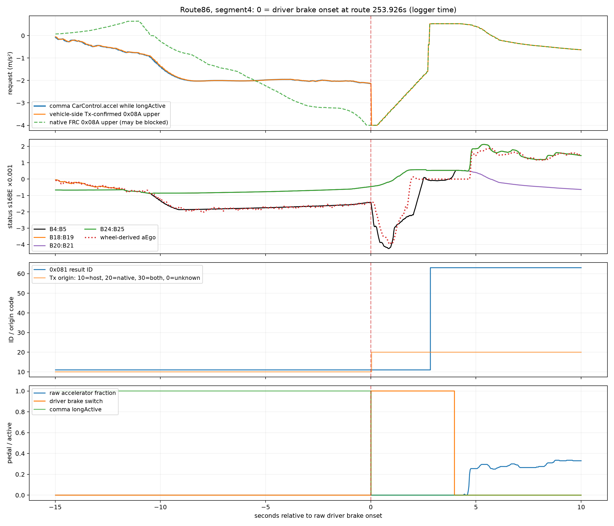
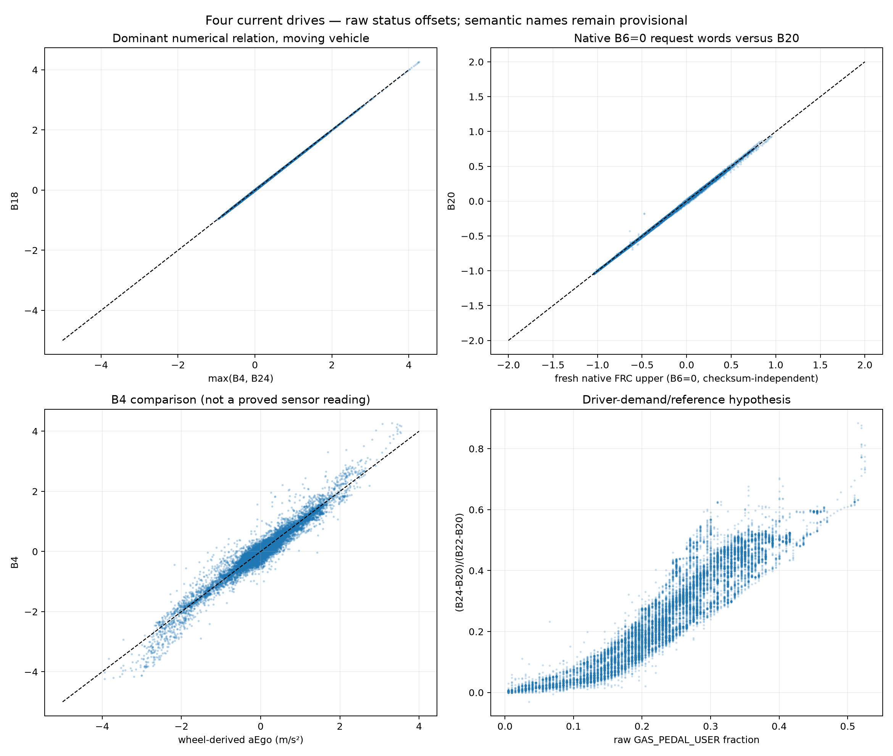

# 2026 Camry longitudinal request and result evidence

This report owns the wire semantics and capture analysis. The
[capability matrix](camry-2026-capability-matrix.md) owns current port status;
the [port report](camry-2026-tss3-opendbc-port.md) owns implementation.

`0x08A` carries the shared lateral and longitudinal application request.
Brake-owned `0x081` publishes downstream result/status.
`0x160` is FRC-origin state/evidence, not the Camry port's command interface.

The current architecture is more precise than the earlier shorthand
"FRC request -> Brake arbitration." Toyota Motor Corporation's
US20200070849A1 describes a generic vehicle-movement interface in which each
**request longitudinal ID is the identifier of an application**. A request
arbitration unit independently selects lower- and upper-limit longitudinal IF
packages from the applications; request-generation units then carry the
selected application IDs/accelerations toward the powertrain and brake
controllers. The powertrain additionally compares the selected application
request with the driver's accelerator request. The reported
`arbitration result_longitudinal ID` is the selected application's ID when the
application request is employed, or a distinct value that identifies a driver
request when the driver wins. The patent also defines the analogous lateral ID
as an application identifier. This generic Toyota architecture closely matches
the recovered `0x08A/0x081` behavior.

That distinction explains the ID63 observation cleanly. Camry `0x08A`
B6[7:2] carries candidate request IDs 0 and 11 in the two complete drives;
ID63 is observed in Brake/VMC-owned `0x081`. Toyota labels 63 `Driver
Operation` on a P5 FRC diagnostic display surface. **`0x08A` B7 is a
checksum, not a second request ID/allocation byte**; the lower-slot
requester and allocation remain unmapped. The supported model is
FRC-submitted acceleration bounds in `0x08A`, with downstream
arbitration/employed-source feedback in `0x081`.

The retained source document is local-only under
`REFERENCE/patents/toyota_vehicle_movement_arbitration_patent/US20200070849A1.pdf`
(`REFERENCE/` remains intentionally ignored). Public source:
<https://patents.google.com/patent/US20200070849A1/en>.

Transport, request semantics, physical publication/security ownership, and
actuator authority remain separate questions. Later source-direction evidence
places protected `0x08A` publication inside the FRC assembly, while the recovered
Toyota architecture places request arbitration downstream in the Brake/VMM
layer. The exact Brake code implementing that arbitration and the security/physical
handoff remain unresolved; the archive-wide unequal-bound census now strongly resolves
ordinary Camry A/B ordering as upper/lower.

**Request/result wire closure:** FRC normal-Tx suppression establishes `0x08A`
as the upstream TSS request/instruction plane; Brake owns `0x081` and continues
publishing it with request-loss supervision if the FRC request disappears. The
byte-level audit maps `0x08A B8:B9` to the ordinary-DRCC upper bound and
`B11:B12` to the lower bound at signed16 x0.001, and maps `0x081 B6[5:0]` as
the strongest `5284` employed-source-ID candidate. An early draft also read
`B20:B21` as the `57DB` result-acceleration candidate; the
[2026-09-30 VMC status corpus](#2026-09-30-vmc-status-corpus) corrects that:
`B20` is a closed-accelerator reference; `B4:B5` and `B18:B19` are candidate
combined and drive-side quantities, respectively. Neither is OEM-joined to `57DB`.
The [braking-ceiling comparison](#repeated-braking-ceiling-and-request-policy-candidate)
narrows the weak-braking behavior; the subsequent
[stock scene comparison](#stock-following-versus-free-cruise-association) makes a
companion request-policy mismatch the leading hypothesis.
`0x0CA` remains protected longitudinal/chassis state but is no longer the primary
result interpretation. See `data/generated/camry_2026_longitudinal_request_plane.json`.

## September 16: command versus feedback audit

Inputs are both complete tracked August-27 CAN captures and seven original
rlog segments: September-11 combined trial `000000d4--327b2c4bb8`, segments
2–5, and September-4 stock routes `0000003b--62262eb7a1` segment 84 and
`0000003c--97b9e7a69a` segments 26–27. Selected original frames, publication
timestamps, source-file identities, and SHA-256 values are retained in
`tests/fixtures/camry_20260916_longitudinal_motion_audit.jsonl.gz`. No live vehicle access,
new sender, firmware change, or production port change is part of this audit.

The reducer is
`tools/targets/camry/analysis/analyze_camry_20260916_longitudinal_motion_audit.py`; its
portable result is `data/generated/camry_20260916_longitudinal_motion_audit.json`.

### B4:B5 is feedback-like on this Camry

The existing signed-15/0.001 interpretation closely reproduces a derivative of
independent `0x0AA` wheel speed. This is not a comparison against our own
controller request or against another presumed command field. At speeds above
2 m/s and with the native cruise-operating latch clear:

| Complete capture | Samples | Correlation with measured acceleration | Fitted measured/field slope | Intercept (m/s²) |
|---|---:|---:|---:|---:|
| August drive A | 7,032 | 0.971345 | 0.966845 | −0.000761 |
| August drive B | 9,822 | 0.988851 | 0.970301 | −0.002508 |

These figures compare the field against a 400-ms centered wheel-speed
derivative 100 ms earlier. The same-time correlations are also high:
0.965798 and 0.986154. The all-moving populations give 0.966444 and 0.986667
at the −100-ms shift. The cruise-active subset of drive A has little excitation
and a much weaker relationship (r=0.616232); do not hide it or claim universal
per-regime precision. Both complete PDU streams pass the recovered CRC:
20,510 and 23,998 frames.

The negative shift is consistent with estimated/filtered motion being
reported after the physical change. It is **not a measured ECU or actuator
latency**: CAN publication times and the derivative filter both contribute.
The analysis rejects invalid wheel samples, long interpolation gaps,
extrapolation, future cruise-state samples, and joins across source files.

The stock start transients are a separate discriminator. Using the first
mean-wheel speed above 0.1 m/s near each previously identified resume:

| Stock resume | First nonzero B4:B5 after motion | B4:B5 at +200 ms | Mean wheel speed at +200 ms |
|---|---:|---:|---:|
| `3b`, near 5122.256 s | 261.861 ms | 0 | 0.479 m/s |
| `3c`, near 9068.054 s | 222.947 ms | 0 | 0.472 m/s |
| `3c`, near 9147.517 s | 252.375 ms | 0 | 0.472 m/s |

An unconstrained acceleration-demand interpretation for this field does not
explain these stock starts: the vehicle is already accelerating while the fine
field remains zero. A measured-acceleration/estimated-motion role is the
stronger interpretation.

### Independent chassis-state and ego-speed cross-check

A second reduction in the maintained motion-audit producer checks both complete
August captures against raw chassis messages. This adds an independent check to
the wheel-speed derivative and current port signal names. Inputs are tracked;
regeneration needs neither `REFERENCE/` nor `build/`.

| Cross-check | Drive A | Drive B |
|---|---:|---:|
| Fine B4:B5 vs native `0x13C` acceleration-like word, all samples: r | 0.979516 | 0.989355 |
| Same comparison, cruise off: r | 0.979857 | 0.988391 |
| Cruise-off median absolute difference (m/s²) | 0.005 | 0.013 |
| Packed speed vs valid raw wheels above 2 m/s: r | 0.999758 | 0.999936 |
| Speed median absolute difference (m/s) | 0.018750 | 0.020139 |
| Moving speed samples | 8,930 | 14,413 |

The packed speed candidate spans B7:B9. Its observed numerical encoding is
compatible with the existing Toyota wheel-speed representation. Invalid wheel
flags are rejected. The acceleration comparison uses the preceding chassis sample
within 100 ms; speed uses the preceding wheel sample within 80 ms. Neither
joins across original source files or consumes a future sample at the queried
instant. The `0x13C` word remains described structurally; the independently
derived physical acceleration and stock-start evidence are what anchor its
measured-motion interpretation.

This substantially strengthens the **ego-state publication** interpretation
of the PDU. Our DBC name `TSS3_LONGITUDINAL_REQUEST` is a project-assigned hypothesis.

### B12 timing favors a return-derived quantity, but does not measure a path delay

A native-sample sweep, restricted to the stock cruise-operating intervals,
aligns B12 best with `0x0CA` **50 ms earlier in both complete drives**:
r=0.951994 and 0.989911. However, same-time r is already 0.951673 and 0.989495.
The peak is shallow. The separately reviewed fixed-25-ms-grid role reducer
places its maxima at -50/-75 ms; this sampling dependence is another reason
not to claim an exact 50-ms or 75-ms ECU delay or causal chain.

The supported statement is narrower: the data does not show B12 uniquely
leading the result-like chassis channel. The three stock starts and the
intact-native comparator below provide more discriminating evidence than the
lag maximum alone. A state export derived from an already selected result, or
parallel outputs of a common internal calculation, both remain compatible.
There is no established byte-copy from a different FRC command.

The follow-up independently re-extracted the 28-source role-audit fixture
from the original rlogs: **306,073 publication events** reproduce byte-for-byte
(SHA-256 `c15b4e9544fc73624fe8aff09c2f40cda8196039de4eb83cee038605f37c2833`).
The companion role audit below was completed separately during this review.
The maintained motion-audit producer and its seven-source fixture independently
own the core physical-motion, native-comparator, resume, and direction checks;
the new cross-checks above use the already tracked full August captures.

### Combined replacement does not establish host influence

All **1,249** host frames can be paired to a CRC-valid preceding camera frame
with the **same B2 counter** in the same original source file. Source ages are
1.619–2.733 ms (median 1.879 ms). Each match is local and time-bounded, so the
8-bit wrapping counter is disambiguated. All 1,249 have a byte-identical returned
Panda TX within 3.892–21.305 ms.

B4:B5 differs from its native source in 1,243 frames; B12 differs in 970.
Comparing the result-like `0x0CA B7:B8` with the intact source and replacement:

| `0x0CA` observation time relative to host | Intact native B12 correlation | Replacement B12 correlation |
|---|---:|---:|
| −100 ms | 0.932004 | 0.671457 |
| Nearest time | 0.930230 | 0.700465 |
| +100 ms | 0.923148 | 0.727055 |

Correlations use the historical `−0.1 × signed7(B12)` convention to align the
sign. The assumed magnitude is not a newly proved actuation scale. Restricting
to the **970 frames where the two B12 values actually disagree** preserves the
result: at nearest time native r=0.926554 versus host r=0.696919.

The native quantity is still the better predictor, including of a result
published before the host frame. Closed-loop co-movement can explain the
previously quoted host/result correlation without the modified field causing
it. This does **not** prove an effect is exactly zero; it invalidates that
correlation as independent evidence of acceptance, and it invalidates "DRCC
clamping" as an established explanation. The preceding cruise mode is
conventional-active `0x90` for 1,247 frames and conventional-available `0x88`
for two transition frames. Healthy adaptive-mode behavior is not represented.

### B12-before-motion is not B12-before-the-native-output

At 500 ms before the wheel-defined motion onsets, the three `0x0CA` result-like
values are already **+0.453, +0.335, and +0.516 m/s²**, while B12 remains at its
preceding baseline (+0.1, −0.1, and 0 under the historical comparison convention)
and B4:B5 remains zero. B12 changes later but still before wheel motion.
The result artifact contains the complete neighborhoods, including threshold-crossing
timestamps.

The three stock segments also directly separate native traffic from Panda
returns: `0x0CA` has **7,641 native bus0 frames and 7,641 returned bus2 TXs
(src=130)**, with no native bus2 copy. It is a chassis-to-camera publication on
the temporary repin. In these same captures `0x160` is native on bus1. On the restored stock harness, the
camera link is the split bus2→bus0 pair and `0x0CA` is on unsplit bus1.
Toyota network numbers and Panda indices must not be mixed across harnesses.
The exact chassis ECU that publishes `0x0CA` remains unassigned here.

### What GTS and the source inventory do—and do not—establish

Direct reads of the retained `FRC_P5.ddb` expose both estimated motion and
request/output vocabulary. DID `0x1253` names **Estimate Vehicle Acceleration**.
DID `0x1B08` contains **Driver Acceleration for Output**, **Acceleration Limit
for Output**, and **Acceleration for Output**.

The previously proposed `0x1B03..0x1B07` join is specifically an **ISA**
upper-limit/permission surface. Brake `0x10A1..0x10A4` and the TSS operation-FFD
request and arbitration records provide additional semantic candidates.

The September-1 source-isolation notebook supports FRC normal-Tx ownership of
`0x160`. In the two August captures, the `0x0C9` member of the same recorded source
group has only one changing application word, B12:B13, with zero header/counter/trailer.

**Implementation consequence:** keep the Camry alpha encoder explicitly
unqualified and retain the intact native comparator in future analyses.
The available data supports exported/feedback-like quantities more strongly than
it supports the claimed direct control path.

Reproduce without `REFERENCE/`, `build/`, original September rlogs, or a car:

```bash
uv run --locked python -m tools.targets.camry.analysis.analyze_camry_20260916_longitudinal_motion_audit
tools/test camry_20260916_longitudinal_motion_audit
```

The optional `--extract-fixture` path rereads the seven external originals using
an existing openpilot Python environment; it does not call vehicle tooling.


### Independent original-source recheck and the meaning of "echo"

The follow-up review reread the **28 original rlogs** selected by the expanded
local role analysis: September-11 `d1` segments 3–6 and 9–12, `d4` segments 0–6,
historical relay-direction route `2d` segments 0–5, September-4 `3b` segments
83–85, and `3c` segments 25–28. The last two groups retain the declared
four-second neighborhoods around the three stock-resume landmarks.

Re-extraction produced **306,073 original publication events** and was
byte-identical to the existing expanded local fixture
`tests/fixtures/camry_2026_longitudinal_role.jsonl.gz`
(SHA-256 `c15b4e9544fc73624fe8aff09c2f40cda8196039de4eb83cee038605f37c2833`).
Both `tools/test camry_20260916_longitudinal_motion_audit` and the existing
worktree suite `tools/test camry_2026_longitudinal_role` passed. The expanded
role files were already pending at the start of this review and were not
staged or altered; the committed seven-source motion audit above remains the
portable source for its reported conclusions.

The expanded comparison supplies useful independent corroboration: native
B4:B5 agrees with the chassis `0x13C` signed-15 numerical channel in both August
captures (r=0.979516/0.989355; median absolute difference 0.006/0.014 m/s²), and
a separate packed speed candidate in `0x160` agrees with raw wheel speed
(r=0.999789/0.999942).

The disposition distinguishes three findings:

- **FRC-origin publication:** supported by source isolation and camera-side observations.
- **Fine acceleration field:** motion/feedback-like on the captured Camry.
- **B12:** related to a native longitudinal result that can precede physical
  motion. Its best native alignment follows `0x0CA`, and the untouched native
  comparator outperforms the replacement during the combined trial. This
  favors an exported state/result interpretation.

The leading working model is an FRC publication of ego-motion and
longitudinal-state information onto the ADAS link, potentially for other
perception participants.

This follow-up changed the review only. No vehicle interaction, sender,
controller, Panda rule, firmware, or experimental-mode default was changed.
`REFERENCE/` and `build/` remain ignored and were not staged.

## Expanded passive review: physical source is not control authority

The pending role audit was independently re-extracted from **28 original rlog
segments**. Its **306,073 retained publication events** reproduce the existing
fixture byte-for-byte (SHA-256
`c15b4e9544fc73624fe8aff09c2f40cda8196039de4eb83cee038605f37c2833`). Both complete
August captures were then reprocessed independently of those September logs.
The expanded evidence lives in:

- `tools/targets/camry/extract/extract_camry_2026_longitudinal_role.py`
- `tools/targets/camry/analysis/analyze_camry_2026_longitudinal_role.py`
- `tests/fixtures/camry_2026_longitudinal_role.jsonl.gz`
- `data/generated/camry_2026_longitudinal_role.json`

**Working diagnosis:** the examined Camry fields fit an FRC publication of ego
motion and selected longitudinal state better than a direct independent
acceleration-demand interface. A perception/radar-side state report is the
leading architectural interpretation. The correlated `0x0CA` channel travels from
the chassis side toward the camera on the historical split.

### Independent ego-state comparisons

With no additional unit fit, the fine field agrees with the acceleration-like
quantity in chassis `0x13C`: all-sample correlations **0.979516 / 0.989355**, with
median absolute differences **0.006 / 0.014 m/s²** in August A/B.

A separate packed speed-like field in `0x160` follows mean wheel speed with
correlations **0.999789 / 0.999942** and median absolute differences about
**0.019 / 0.020 m/s**, above the declared low-speed cut. The selected packet
therefore contains ego-state information. Invalid wheel flags are excluded.

In the restored-harness d1/d4 captures, with cruise disengaged and speed above
2 m/s, the fine field also agrees with the independently wheel-derived
`carState.aEgo`: **r=0.970690 / 0.957737**, using **6,096 / 6,503** samples.

### B12 timing is consistent with a report, but is not a causal clock

The complete native sweeps align B12 best with `0x0CA` **50 / 75 ms earlier**.
However, the level-correlation gain over zero lag is only
**0.000258 / 0.000472**; correlations of 200-ms changes peak at just
**0.185 / 0.455**. The peaks are broad, the series autocorrelated, and rlog
publication timestamps are shared by a CAN batch.

The actual start neighborhoods are more useful. Relative to the first three
consecutive raw-wheel samples above 0.025 m/s:

| Stock resume | `0x0CA` result-like field persistently >0.5 m/s² | Fine field persistently >0.05 m/s² |
|---|---:|---:|
| 3b / 5122.256 s neighborhood | −441 ms | +272 ms |
| 3c / 9068.054 s neighborhood | −372 ms | +263 ms |
| 3c / 9147.517 s neighborhood | −482 ms | +262 ms |

These definitions use a different threshold from the 0.1 m/s onset /
first-nonzero-field table above. No gas, brake, RES, SET, or CANCEL
assertion is present in the declared −1.0 to +0.5 s windows. At the −500-ms
landmarks, `0x0CA` is already positive while B12 is still at its preceding
baseline.

### Actual replacements and the native comparator

The expanded d1 selection contains **10,259** host frames, **10,228** changed
fine fields, and no B12 modifications. The d4 selection contains **1,249** host
frames, **1,243** changed fine fields, and **970** changed B12 fields. Every host
frame has a source/time/counter-matched native template and valid CRC; d4 has
**1,249/1,249** exact returned TX payloads. All changed bytes are confined to the
historical encoder's declared fields and CRC.

At a common 25-ms grid during d4 replacement, native B12 versus the `0x0CA`
result-like channel has **r=0.931904**, while replacement B12 has **r=0.699657**
(**1,244** observations). All 1,244 have a preceding conventional-active `0x90`
mode observation within 1.5 s. The age bound reflects the slow mode message;
unknown-mode observations remain explicitly counted instead of silently labeled.

The host and stock controllers share a moving scene, and the camera continues
to observe the car while its ADAS-side output is being replaced. Either closed
loop can correlate with the same motion. The better intact-source fit defeats
the previous correlation-only proof of host authority.

### Source ownership, vocabulary, and remaining information boundary

The September-1 notebook §19 records `0x160` **40 → 0 → 40** under FRC normal-Tx
suppression/restoration on the observed ADAS network. This supports the FRC
publication source. The full six-segment
historical relay capture has `0x0CA` **13,756 native bus-0 RXs** and **13,256
returned bus-2 TXs**, versus only 503 startup/native bus-2 observations. FRC-side
`0x08A` has the opposite dominant direction. On the restored stock harness,
`0x160` is the camera-side ADAS source and `0x0CA` remains on the unsplit chassis
network. Panda bus indices are not Toyota network numbers.

Direct GTS DDB queries reproduce `FRC_P5` DID `0x1253` (estimated acceleration)
and `0x1B08` (separate driver, limit and output accelerations). `0x1B03..0x1B07`
are ISA-specific request/permission observables. Brake `0x10A1..0x10A4` name TSS
requests. The current checked-in firmware inventory contains EPS applications.
The candidate re-rank below identifies a protected chassis-facing request carrier.

### Longitudinal candidate re-rank after topology normalization

The earlier search mixed three harness eras too easily. Raw Panda bus numbers are
therefore normalized to Toyota network role before any candidate is compared:

| Capture era | Panda CAN0/CAN2 relay pair | Panda bus 1 | Longitudinal interpretation |
|---|---|---|---|
| Stock Toyota-B before the temporary repin | Toyota Bus 1 camera/ADAS: source side bus2 -> downstream bus0 | Toyota Bus 4 Brake/EPS/chassis, unsplit | Same physical wiring as the restored configuration below; direct-Panda ELM327 mux state is a separate axis |
| Temporary CAN0/CAN1 repin (Aug-27 through lateral development) | **Toyota Bus 4**: upstream `0x08A/0x0C9` on bus2 -> chassis bus0; `0x0CA` returns bus0 -> bus2 | **Toyota Bus 1** camera/radar/FRC P05 family | Healthy Sep-4 DRCC routes `3b/3c` are in this era |
| Stock Toyota-B restored in the Sep-11 integration cleanup | **Toyota Bus 1** camera/ADAS: FRC `0x020/0x160/0x230/0x440` source bus2 -> downstream bus0 | **Toyota Bus 4** request/result/chassis family `0x08A/0x0C9/0x0CA`, unsplit | Current production-shaped topology |

`harnessStatus=flipped` describes harness/cable orientation. Physical CAN0/CAN1
repinning is a separate configuration. Panda sources 128/130 identify returned
host-TX echoes. The regenerated stock-topology artifact checks all
seven request/result candidate IDs explicitly rather than inferring this mapping
from unrelated state messages.

With that normalization, protected Bus-4 **`0x08A` is the strongest direct
chassis-facing longitudinal candidate**. It was already recovered as a
multi-function TSS request/state PDU carrying Target Lateral ID and target
steering angle. The complete August captures add a second, independent shape:

- B8:B9 and B11:B12 are signed16 words and are **identical in 44,617/44,617
  source-side frames** across the two complete drives;
- their raw ranges are -1146..+995 and -1102..+1070, naturally giving
  -1.146..+0.995 and -1.102..+1.070 m/s² at 0.001 m/s²/count;
- the prior complete-capture census independently bounded these words away from
  simple measured-motion/steering interpretations: all four joins against
  wheel-derived acceleration, steering angle, driver torque, and target-angle
  rate have `|r| <= 0.0967`;
- in all three no-driver-input Sep-4 stock resumes, the B8/B11 value is already
  positive **500 ms before wheel motion** (+0.350, +0.277, +0.391 m/s²) and has
  risen to +0.828/+0.605/+0.590 m/s² at the wheel-defined onset. The duplicated
  words remain equal throughout these retained neighborhoods.

Current P5 Brake/Booster/EPB dictionaries expose `0x10A1` **Request
Acceleration of Upper Limit from Toyota Safety Sense** and `0x10A2`
**...Lower Limit...**, both signed16 at 0.001 m/s², plus 6-bit upper/lower
request IDs (`0x10A3/0x10A4`) occupying bits7:2 of their diagnostic fields.
Those offsets are not CAN offsets. `0x08A B6[7:2]` remains a request-ID
candidate, with B6[1:0] an allocation candidate; active Camry cruise uses
ID11/allocation1. **B7 equals `(0x8A + 8 + sum(B0..B6)) & 0xFF`**,
the eight-byte-prefix Toyota checksum. Its old lower-ID/allocation mapping
is withdrawn.
The FRC-hosted PCS Operation-FFD recorder independently contains record `5280`
"TSS required acceleration (lower limit)" and `5281` "TSS request acceleration
(upper limit)", again signed16 at 0.001 m/s², as well as longitudinal IDs,
braking/driving-force allocation, and arbitration-result records.

The original two-drive result did **not** resolve upper-versus-lower ordering because
B8:B9 == B11:B12 in all 44,617 frames in that selected corpus. A 2026-09-22
archive-wide raw-log census supersedes that limitation. Scanning every recoverable
`rlog.zst` / `*.rlog.zst` under `~/dev/inspect/logs` with `LogReader`, and retaining
native-RX `0x08A/32` observations (`src < 128`), yields **1,505,266 observations from
605 rlogs**. Only 48 have unequal B8:B9/B11:B12 values, but 12 of those are the
ordinary Camry DRCC raw header state `B6=0x2D`, `B7=0x47`, spread across six
independent route segments as two-frame episodes. Their `(B8:B9, B11:B12)` values in
m/s² are `(+0.682,-0.769)`, `(+0.687,-0.437)`, `(+0.217,-0.442)`,
`(+0.432,-0.659)`, `(+0.215,-0.452)`, and `(-0.621,-0.701)`: **A > B in 12/12
ordinary-DRCC unequal frames**. The first five episodes occur immediately before
B6 drops to zero; the sixth occurs on an idle-to-active transition. This supports
ordinary DRCC **B8:B9 as the upper acceleration bound and B11:B12 as the lower**.
The checksum supplies no lower-bound requester identity.

The other 36 unequal observations are one distinct route-45 intervention family with
B6=`0x35`, B5=`0x04`, B8:B9 sweeping `-0.175..-0.500 m/s²`, and B11:B12
held at zero. This header state differs from ordinary DRCC and must not be
used to invert its bound ordering; the intervention's application semantics remain unnamed.
This still stops short of a synchronized literal DID-to-byte proof for `0x10A1..0x10A4`,
but the ordinary-DRCC A/B upper/lower ordering is no longer open.

The alternatives now rank as follows:

1. **Protected `0x08A` B8:B9/B11:B12** — strongest direct downstream TSS
   acceleration-request candidate.
2. **Protected `0x5AF` B26** — a coarse longitudinal companion. Interpreting B26 as signed 6-bit gives
   a reproducible fit of **0.251/0.246 m/s² per count** against the `0x08A`
   request word (r=0.756/0.857), but its best alignment is **50/75 ms after**
   `0x08A`. Around the three stock resumes it steps through small signed values
   as the fine request rises. Low-rate `0x5F7` B7 shows a similar coarse family
   (raw signed6 values are multiples of four; fitted scale is ~0.062 per raw
   count, i.e. ~0.25 per four-count step) and likewise does not lead `0x08A`.
   These are better treated as quantized request/result/status companions than
   as the originating acceleration command; no OEM field name is assigned.
3. **`0x0C9`** — upstream-to-chassis and therefore directionally plausible as
   sideband/request metadata, but B12:B13 correlates only weakly with `0x0CA`
   (best |r| 0.265/0.140 in the two complete drives) and remains `0x1838`
   through the early portion of all three stock-resume ramps. It is not the
   leading acceleration-magnitude carrier.
4. **`0x0CA`** — other protected longitudinal/chassis state in the wrong
   direction for an FRC request. The newer `0x081` request/result audit supersedes
   the old B3:B4/B5:B6/B7:B8 arbitration-result interpretation.

The direct FRC Toyota-Bus-1 P05 candidates `0x020/0x160/0x230/0x440` were also
screened against the protected `0x08A` request word using every byte-aligned
8/16/24/32-bit signed/unsigned BE/LE field and +/-300 ms lags. `0x020`, `0x230`,
and `0x440` have **no** same-sign field reproducing at |r| >= 0.25 in both
complete drives. `0x160` has moderate state-related correlations (best
min-|r| 0.631), but those maximize at the **+300 ms search boundary** and overlap
its already recovered ego-state structure.

A second screen covers all **47 recurring protected Bus-4 PDUs** that vanished
under the Sep-1 FRC CommunicationControl normal-Tx suppression. `0x08A` itself
is excluded as the reference. Every byte-aligned signed16-BE field plus
signed-low6 fields is compared in both complete drives. This recovers the
coarse `0x5AF`/`0x5F7` companions above, but **no second same-scale signed16
acceleration carrier**. The retained CommunicationControl experiment establishes
`0x08A` as the upstream TSS request-side plane.

The maintained port intercepts the request source on the repinned relay
topology; see the [runtime contract](../architecture/toyota-tss3-minimal-runtime.md).
Stock-harness captures remain wire-format evidence but do not define runtime
bus placement.

`0x08A` is the central observed continuous request PDU and already carries the full
recovered lateral request family plus the strongest longitudinal acceleration
request candidates. Toyota's FRC-hosted recorder also exposes upper/lower
longitudinal request IDs, braking/driving-force allocation, shift/EPB,
override/priority and other request metadata whose exact wire locations are not
all mapped. Ordinary FRC state/display/ego-motion publications (`0x020`,
`0x160`, `0x230`, `0x440`, `0x371`, `0x412`, etc.) also exist outside `0x08A`.


### Request/result recorder layout: what is actually mapped

Toyota's architecture changes the meaning of the longitudinal pair. The lower and
upper packages are independently arbitrated **bounds** on allowed acceleration.
The downstream powertrain compares driver demand
with those bounds and clips it into the selected range; the longitudinal result ID then
reports the request source whose acceleration was actually employed. This explains why
result ID63 (`Driver Operation`) can appear while the observed `0x08A` B6
request-ID candidate is not 63; the lower requester field is not mapped. Equality of the two retained acceleration words means the observed bounds collapse
to the same value in those states, or that a remaining wire/order assumption needs
refinement; it must not be described as intentional duplication by design.

GTS independently preserves the request-generation boundary described by Toyota.
Brake-domain P5/P6 databases expose `0x10A1..0x10A4` as upper/lower requests **from
Toyota Safety Sense**, then separately expose `0x10A5..0x10AA` as upper/lower target
acceleration, target ID, and target driving force **from Vehicle Motion Control**. That
is the diagnostic equivalent of application request -> arbitration/request generation
-> controller target.

The recorder schema and wire evidence now line up as follows. "Strong candidate"
means the width/scale, topology, and dynamic arbitration behavior match, but no
synchronized diagnostic/FFD value directly names that wire field.

| Toyota recorder quantity | Wire disposition | Evidence status |
|---|---|---|
| `5280` lower longitudinal request ID | unmapped | former B7[7:2] mapping withdrawn: B7 is a checksum |
| `5280` lower acceleration | `0x08A B11:B12`, s16 x0.001 m/s² | strongly resolved for ordinary Camry DRCC |
| `5280` force distribution | unmapped | former B7[1:0] mapping withdrawn |
| `5280` shift / EPB / override / priority | unresolved | complete-drive byte census does not justify an OEM-name assignment |
| `5281` upper longitudinal request ID | `0x08A B6[7:2]` candidate | B6 agrees with selected result ID11; synchronized diagnostic join remains open |
| `5281` upper acceleration | `0x08A B8:B9`, s16 x0.001 m/s² | strongly resolved for ordinary Camry DRCC |
| `5281` upper force distribution | `B6[1:0]` | strong structural join; synchronized DID oracle still absent |
| `5282` lateral request ID | `0x08A B21[5:0]` | recovered |
| `5282` requested pinion angle | `0x08A B18:B19` | recovered; controller scale is 0.00100012 rad/count versus recorder 0.001 |
| `5282` steering assist gain | `0x08A B24` x0.01 | strong structural join |
| `5282` damping gain | `0x08A B25` x0.01 | bounded; zero in both complete drives |
| `5284` arbitration-result longitudinal ID | `0x081 B6[5:0]` | strong candidate; observed values 11 and 63 |
| `5285` arbitration-result lateral ID | `0x081 B13[5:0]` | recovered |
| `57D3` acceleration-valid flag | unresolved | `0x081 B11[4]` is proven request-loss supervision, but is not OEM-joined to `57D3` |
| `57DB` arbitration-result acceleration | no confirmed wire join | `B20:B21` is a closed-accelerator reference candidate; `B4:B5` and `B18:B19` are candidate combined and drive-side quantities. Their distinction matters under braking; neither has a synchronized diagnostic join to `57DB` ([status reconstruction](#message-structure-and-drivebrake-decomposition)) |
| `57DE` arbitration-result pinion angle | `0x081 B16:B17` | recovered |

The B6 candidate has an independent arbitration check. Selected `0x081`
result ID11 equals `0x08A B6[7:2]` in **1,525/1,529** Drive-A and
**3,276/3,281** Drive-B ID11 samples. Every selected ID63 sample
(**15,544 / 16,718**) differs from the B6 candidate. Toyota's P5 FRC
diagnostic vocabulary includes `63 = Driver Operation`, consistent with
the patent's distinct result-side driver discriminator.

The delayed-stop corpus retains **198** frames with B4[5] set while the
B3[3] cruise latch is set, across three hold episodes in routes `3b/3c`.
Ordinary raw B6/B7 pairs `0x2D/0x47` and `0x2C/0x46` become
`0x2D/0x67` and `0x2C/0x66` when B4[5] adds `0x20` to the checksum.
These are not two requester identities or independent hold corroboration.
The hold analysis now selects B4[5] directly; its exact OEM recorder name
remains unassigned.

### Longitudinal request IDs versus result-source IDs

Keep FRC request metadata and Brake/VMC result IDs distinct. `0x08A` B6
contains the observed request-ID candidate; the lower requester remains
unmapped. `0x081` carries the downstream **employed-source result ID**,
which can identify the driver.
The current Toyota corpus
does not contain one complete longitudinal 0..63 request enum analogous to EMPS
`Target Lateral ID`. A six-region sweep
of current GTS+ and Techstream V18 (NA/EU/JP; 3,207 DDB files total) found the
same sparse named anchors but no hidden complete `5280/5281/5284`, `0x1284`, or
P6 longitudinal-arbitration value dictionary. The tracked request-plane producer
now extracts the relevant labels directly from Toyota DDBs rather than hard-coding
them.

The working namespace is:

| ID | Longitudinal evidence | Lateral comparison | Current disposition |
|---:|---|---|---|
| **0** | P5 FRC ISA Vertical ID names `No Request`; Camry request A uses 0 while idle | `No Request (Manual Operation)` | common no-request anchor |
| **9** | P6 Speed Limiter Requesting Vertical ID explicitly names `ISA` | no generation-20 lateral label | named cross-generation longitudinal/vertical anchor; not observed on Camry `0x08A` |
| **11** | Camry request A during ordinary DRCC; `0x081` result ID11 when that application request is employed | LTA/LCA | **strong shared-TSS-application-ID hypothesis** |
| **17** | retained 2025 Corolla active B6 candidate | no lateral label | observed B6 requester candidate; OEM name unknown |
| **18** | not observed in Camry B6 in the two complete drives | SDG; P6 PDA-SA lateral request also uses 18 | lateral-only named anchor; no longitudinal transfer |
| **41** | P6 MaaS lower-limit longitudinal ID = `Request 1 of MaaS Autonomous Driving System` | AD (Lv.4) | plausible shared automated-driving application identity |
| **45** | P6 MaaS lower-limit longitudinal ID = `Request 2 of MaaS Autonomous Driving System` | DES (Lv.4) | plausible shared automated-driving application identity |

**Result-side-only observation:** longitudinal ID63 is OEM-labeled `Driver Operation`
on a P5 FRC diagnostic display surface and is observed in Brake/VMC-owned `0x081`.
It is absent from the B6 candidate in the retained Camry and Corolla evidence.
The checksum cannot establish presence or absence of another requester.

With the checksum removed from the selection predicate, every stable raw
**B6=0** request pairs with Brake/VMC longitudinal result ID63:
**18,645/18,645** Drive-A and **19,441/19,441** Drive-B. Above 1 m/s,
the counts are **7,713/7,713** and **10,563/10,563**. Drive A gains 37
stable pairs that the old checksum-derived filter excluded.

B11:B12 remains dynamic during B6=0. With accelerator=0, gear D, and
matched brake-pedal press edges below 1 m/s, all **9/9** events reduce the
slot: Drive-A 4/4 (median −0.0295 m/s²), Drive-B 5/5 (median −0.036 m/s²).
Combined changes span −0.071 to −0.0265 m/s². With the brake released,
Drive-B medians fall from +0.468 m/s² below 0.15 m/s to +0.277 at
0.15–0.5 m/s and +0.202 at 0.5–1.0 m/s. These are acceleration-slot
observations; the former “ID4 application” was a checksum decoding error.

Toyota's patent record supplies a possible physical interpretation.
`US20200070849A1` defines the lower longitudinal package as the
**minimum acceleration requested by an application**, separately reports the powertrain's
**full-closed estimated ground acceleration**, and has the powertrain compare driver
demand against the selected application bounds. Toyota's closely contemporary
`US20200094835A1 / US11285952B2` then describes the physical powertrain **lower limit
of availability** as the fully-closed/throttle-off baseline: it can be negative from
engine braking at speed, but below roughly 8--10 km/h creep torque becomes dominant and
drives that lower limit positive. Older Toyota `JP5195257B2` independently describes
accelerator-off creep torque and creep-cut control under brake demand.

This resembles a **closed-accelerator/manual baseline envelope**: positive
creep at low speed, coast/regen/engine-braking values at higher speed, and
a reduction with brake input. The available evidence does not identify
which application contributes that slot.

Toyota defines both longitudinal and lateral request IDs as application
identifiers. Camry B6 ID11 during ordinary DRCC and lateral ID11 LTA/LCA
remain a possible shared-application clue. The former checksum-derived
ID25 hold attribution supplies no evidence about that namespace.

Toyota also exposes feature-specific longitudinal-ID recorder fields that can
supply future direct joins: `5271` **IFU request vertical ID (lower limit)**,
`5A04` **PDA(OAA) Request Vertical ID**, and `5B07` **Longitudinal Request ID of
Lower Limit from PDA(DA)**, in addition to generic `5280/5281/5284`. The retained
same-car Operation-FFD samples do not contain those longitudinal records, so no
numeric values can yet be attached to those feature names. A future stock
capture that exercises them is a much better enum oracle than inferring names
from numeric coincidence.

The retained FRC CUWs do not currently solve the missing names. Their ReproStd
`.xx` members are Motorola-S-record framing around a manufacturer-encrypted
target representation (DFI encryption method 1); the selected host path does
not decrypt/decompress that application payload. Until that transform is
recovered, the FRC application image cannot be searched as plaintext for an ID
table, and **absence of a firmware enum has not been established**.

The tracked Corolla reducer observes B6 ID0 while idle and ID17 during
active ACC; `0x081` remains result ID63 across all 2,000 retained result
frames. B7 validates as a checksum, withdrawing the former lower IDs4/23.

Across 17,073 / 19,999 request-result pairs in the complete A/B drives,
`0x081 B20:B21` correlates with the request at r=0.941674 / 0.836884. The more
discriminating result-ID split is stronger: for selected ID63 the median
result-minus-request is **0.000 m/s²** in both drives (p10/p90 only a few
0.001 m/s² counts apart), while selected ID11 gives median deltas
**-0.181 / -0.435 m/s²**. That is the behavior expected of an employed-source/result publication rather
than a second request echo. In Toyota's documented architecture, the selected
application upper/lower request may still be constrained or superseded by the
driver request in the powertrain/brake execution layer. The
[2026-09-30 VMC status corpus](#2026-09-30-vmc-status-corpus) later narrowed
which word carries that result-like behavior: these two-drive observations
remain valid history, but `B20:B21` itself is a closed-accelerator reference
while `B4:B5` and `B18:B19` are candidate combined and drive-side quantities.
Neither correspondence establishes the exact `57DB` wire location.

`0x08A` is the observed continuous TSS3 request envelope for the recovered
lateral tuple and longitudinal acceleration slots. B6 metadata remains a
candidate; lower requester/allocation, shift/EPB/override/priority and
validity fields remain unmapped. `0x081` is the Brake-owned
selected/employed-result/reference envelope. Physical publication
ownership alone does not locate every internal selection step.

The reproducible reduction is
`data/generated/camry_2026_longitudinal_request_candidates.json`, generated by
`tools/targets/camry/analysis/analyze_camry_2026_longitudinal_request_candidates.py`
and protected by `tools/test camry_2026_longitudinal_request_candidates`.

Reproduce the portable reductions:

```bash
uv run --locked python -m tools.targets.camry.analysis.analyze_camry_2026_longitudinal_role
tools/test camry_2026_longitudinal_role camry_20260916_longitudinal_motion_audit
```

This review changes only passive evidence tooling and documentation. No ECU,
Panda, authentication, vehicle-control, or firmware operation is performed.
The local research bundle under `REFERENCE/camry_2026_0x160_role_audit/` and
all re-extraction workspace files under `build/` remain ignored/untracked.

## 2026-09-30 VMC status corpus

An archive-wide reduction of Brake-owned `0x081` status traffic **retracts the
present-tense reading of `B20:B21` as the `57DB` result-acceleration candidate**.
Across 1,232,664 native status frames `B20` behaves as a closed-accelerator
reference. The subsequent decomposition strengthens **`B4:B5` as a combined
longitudinal control/force-equivalent quantity and `B18:B19` as a drive-side
result/reference**, both still inferred roles rather than OEM names.
`B4/B18/B20/B22/B24` are signed16BE words read at nominal
**0.001 m/s²/count**; `B26:B27` is a separate signed low-13-bit quantity
whose physical scale remains unresolved. Nothing below is in milli-g.
OEM diagnostic names (`5280/5281`, `5284`, `57D3`, `57DB`) remain
**unjoined hypotheses**: no synchronized diagnostic/Operation-FFD capture
names these words, and this corpus does not change that.

### Scope and source artifacts

| Population | Routes | Segments | `0x081` status frames | Moving rows | Covered time |
|---|---:|---:|---:|---:|---:|
| Primary openpilot-longitudinal drives `86/87/88/8a` | 4 | 50 | 96,593 | 56,524 | 2,898.1 s |
| Historical stock (`openpilotLongitudinalControl=false`) | 21 | 353 | 689,752 | 494,875 | 20,692.3 s |
| Historical openpilot | 19 | 229 | 446,168 | 289,169 | 13,386.1 s |
| All status (union of the above plus two tiny no-mode clips) | 46 | 634 | 1,232,664 | 840,645 | 36,981.0 s |

Route `00000089--0dd1afd752` is primary-flagged but never reaches an openpilot
longitudinal phase; it and `00000042--169d4d611d` are one-segment no-mode clips
(74/77 status frames) counted only in the all-status totals. No vehicle
operations are involved: every source is an existing recorded rlog under an
external logs root.

Raw logs remain external. The committed compact evidence lives in
`data/generated/camry_20260930_vmc_status/`: `input_manifest.json` (per-route/
segment paths relative to the external logs root, sizes, SHA-256, software
metadata, and extraction/join cache identities), `summary.json`,
`corpus_validation.json` (per-route/per-phase recomputation),
`phase_comparison.csv` (route × git-phase aggregates),
`stock_epochs.csv` (the 126 window table), `b18_exceptions.csv` (every
non-exact `B18=max(B4,B24)` row with pedal context),
`representative_samples.json`, and the two plots below. Per-route software
provenance is committed alongside: available `initData` records identify
openpilot `0.11.2`, branches `kai`/`tss3`/`tss3-camry-port`, and per-route
git commits; available `TOYOTA_CAMRY_TSS3` CarParams retain
`openpilotLongitudinalControl`. Extraction/join intermediates are git-ignored
under `build/cache/camry_20260930_vmc_corpus/` and are regenerated on demand;
`--corpus-dir` explicitly accepts an existing extraction directory.

### Method, timing, and origin bounds

The pipeline is extract → join → analyze → plot (commands in
[WORKFLOW.md](../WORKFLOW.md#external-openpilot-rlog-reducers)). The join is
**preceding-only** with request windows of 75 ms and
carState/carControl/carOutput/wheel/pedal windows of 60 ms (plan/selfdriveState
120 ms); every snapshot carries per-source ages. Samples have bounded freshness.
They retain distinct acquisition times and exclude interpolation across gaps.
Covered time sums adjacent status intervals, capping each contribution at
100 ms. It includes parked time and bounds each recording-gap contribution.
`t_route` is seconds from the minimum recorded monotonic
timestamp; cached segment metadata timestamps may repeat and are not playback
anchors. All times are logger/event timestamps and must not be read as
physical wire timing or ECU execution/acceptance deadlines.

Each delivered `0x08A` request is classified by exact 32-byte payload match
against host sendcan versus native CAN traffic (plot legend `10=comma`,
`20=native`). Vehicle-side Tx confirmations establish observed publication.
`ID11` also appears on native stock traffic, so it is **not a comma-ownership
marker**.

The native zero-request-metadata comparison now selects fresh **raw B6=0**,
without conditioning on the checksum. It contains **719,312 rows**, 115
more than the former checksum-derived filter. The 1,232,664-status-frame
scope, 126 stock epochs, and four plotted moving-drive fits are unchanged.

### Six acceleration-like words: candidate roles

| Word | Candidate role | Dominant evidence and bounds |
|---|---|---|
| `B4:B5` | inferred combined longitudinal control/force-equivalent quantity; normally request-following | in every one of 126 excited no-pedal moving stock windows the direct `B4−request` RMS beats the direct `B4−wheel CarState` RMS (medians 0.00921 vs 0.09756 m/s²); `B4−B18` follows the separate driver-brake word during manual braking; −2.458 at held-brake standstill |
| `B18:B19` | inferred drive-side result/reference; empirically `max(B4,B24)` | exact in 1,232,419/1,232,664 frames; `B22 ≥ B18` in all frames; distinct from the combined quantity during braking |
| `B20:B21` | **closed-accelerator reference** | equals `B24` in 1,005,245/1,010,206 fresh closed-pedal frames (~99.5%); mirrors native request words in the fresh B6=0 population |
| `B22:B23` | upper/open-accelerator envelope | `B22 ≥ B18` with zero violations in 1,232,664 frames; `B24` itself exceeds `B22` in 11 frames; exact quantity and speed/gear/grade dependence unresolved |
| `B24:B25` | driver-accelerator demand/reference | rises from `B20` toward `B22` with physical accelerator fraction |
| `B26:B27` low 13 bits | driver-brake-linked signed quantity | nonzero on 121,174/121,175 brake-on frames and negative whenever nonzero (135,686/135,686); remains zero in the route-86 automatic-braking example; physical scale unresolved |

Separately, `B6[7]` — the high bit above the six-bit result ID — is
**standstill-associated in this corpus**: it is set in 363,989 of 370,244
known `CarState.standstill=true` samples and zero known non-standstill
samples or raw-wheel moving rows above 0.5 m/s. Missing CarState samples
are excluded from the CarState denominators.

### Empirical envelope and its exceptions

Raw-count equality `B18 = max(B4, B24)` holds exactly in **1,232,419/1,232,664**
all-status frames (primary drives 96,591/96,593 exact with both remaining
frames within 5 counts; 1,232,427 within ±5 corpus-wide). The 245 remaining
rows split **234 above / 11 below** and are each listed with raw packet and
pedal/gas/brake transition context in `b18_exceptions.csv`. The 11 below
cases are exactly the frames where `B24` exceeds `B22` (routes `3f` and
`16a`, excesses of 5–139 counts). Including that ceiling gives
`B18 = min(max(B4, B24), B22)` exactly in **1,232,430/1,232,664** frames,
with **no below-envelope violations**. The remaining 234 above-envelope
rows are concentrated around braking and stop/launch transitions.

### Independent stock direct-difference comparison

An earlier draft of this comparison reported fitted-gain RMSE figures with
milli-g wording; that wording was **incorrect and is withdrawn**. The maintained
result uses direct differences with **no fitted gain or offset**: in the 126
existing excited no-pedal moving stock windows, comparing fresh vehicle-side
TX/request against `B4` and `B4` against wheel-derived `CarState.aEgo`, all
**126/126** windows have `RMS(B4−request) < RMS(B4−wheel CarState)`, with
medians **0.00921 vs 0.09756 m/s²** (≈0.009 vs 0.098). `B4` tracks the
delivered request far better than measured motion in this population. This
supports a control quantity rather than a literal body sensor; request-following
alone does not choose the OEM result name or distinguish drive-only from combined
braking/driving semantics.

The excitation selector uses an 11-sample centered median of wheel speed
and differentiates only **unique logger-time knots**. Different status
payloads sharing a batch timestamp remain in every status count; only the
derivative's time axis is deduplicated. This avoids zero-time division without
discarding status evidence or treating the selection filter as a latency oracle.

### Representative status states

Values are 0.001 m/s² counts converted to m/s²; ages are logger timestamps.

| Case | Route / segment / t_route | Delivered request (origin) | `B4` | `B18` | `B20` | `B22` | `B24` | Reading |
|---|---|---|---:|---:|---:|---:|---:|---|
| stock braking ramp start | `3f` seg21 t=1318.83 | −0.436 (native) | −0.303 | −0.303 | −0.314 | 3.113 | −0.314 | early request/result transient; wheel aEgo −0.084, result ID11 |
| **weak OP braking before pedal** | `86` seg4 t=253.876497 | −2.123 (comma) | −1.423 | −0.466 | −0.466 | 4.216 | −0.466 | no pedals, requestLoss 0, aEgo −1.453; `B4` under-follows while the envelope words hold the closed-pedal reference; see below |
| driver brake after disengagement | `86` seg4 t=254.028 | −4.0 (native, post-intervention) | −2.249 | −0.442 | −0.442 | 4.249 | −0.442 | brake on, `B26`=8097 raw (−95 as signed13); native request-loss supervision set |
| driver accelerator | `86` seg4 t=259.792 | −0.049 (native, inactive) | 1.649 | 1.649 | −0.082 | 5.760 | 1.649 | gas 0.25; `B24` leaves `B20` toward `B22`; result ID63 |
| normal OP acceleration | `86` seg4 t=272.840 | 0.642 (comma) | 0.636 | 0.636 | −0.461 | 2.960 | −0.461 | native FRC upper was 0.171; `B4` follows the delivered request, result ID11 |
| stationary with brake held | `87` seg0 t=9.973 | 0.666 (native, inactive) | −2.458 | 0.666 | 0.666 | 0.849 | 0.666 | aEgo 0; `B4` is not literal motion at standstill; result ID63 |

For the weak-braking case the full native-shaped status packet is
`00000018fa710b1700000004000b0000003ffe2efe2e1078fe2e0000a47702d5`
(`B4:B5=0xfa71`=−1423, `B18:B19`/`B20:B21`/`B24:B25`=`0xfe2e`=−466,
`B22:B23`=`0x1078`=4216, `B26:B27`=0). The native FRC was already
publishing an upper request of −4.0 **before** driver intervention, while
the vehicle-side publication remained the host's −2.123. Native forwarding
resumed only after the brake press. Driver braking therefore confounds the
subsequent deep deceleration and prevents attributing it to native execution alone.
The [repeated braking-ceiling comparison](#repeated-braking-ceiling-and-request-policy-candidate)
below explains the numerical shape of this gap; its exact policy cause remains open.





### Message structure and drive/brake decomposition

The same 46-route cache supplies an exact additional structural result:
`0x081 B7 = (0x81 + 8 + sum(B0..B6)) & 255` in
**1,232,664/1,232,664 frames**. This is an embedded classic Toyota checksum over
the first seven bytes, inside the 32-byte publication. It is not a rolling
counter or an independent acceleration word. `B0:B3` is always `00000018`
in this population; that constant alone does not identify a length or flag.

The current byte-level reconstruction is:

| Message | Location | Supported interpretation |
|---|---|---|
| `0x08A` | `B3[3]`, `B4[5]` | cruise-operating latch; delayed-hold-associated request state |
| `0x08A` | `B6[7:2]` / `B6[1:0]`, `B8:B9` | upper application ID / allocation / signed16BE acceleration |
| `0x08A` | `B7`; `B11:B12` | eight-byte-prefix Toyota checksum; signed16BE lower acceleration slot (requester/allocation unmapped) |
| `0x08A` | `B10` | requested/set speed, km/h |
| `0x08A` | `B13:B14`, `B16:B17` | unidentified `0x7FFF` slots, constant in all 1,479,225 native request frames examined |
| `0x08A` | `B18:B19`, `B21[5:0]`, `B24`, `B25` | lateral pinion request, application ID, assistance and damping gains |
| `0x08A` | `B20`, `B22`, `B23` | partially understood control-state/policy fields; `B20[7]` needs the distinction below |
| `0x08A` | `B26[5:0]` | request sequence |
| `0x081` | `B4:B5`, `B6[5:0]`, `B6[7]`, `B7` | inferred combined quantity, result-source ID, standstill-associated state, verified checksum |
| `0x081` | `B11[4]`, `B13`, `B16:B17` | request-loss supervision; lateral result ID/status; pinion result/reference |
| `0x081` | `B18:B19`, `B20:B21`, `B22:B23`, `B24:B25`, `B26:B27` | inferred drive-side, closed/open capability, accelerator demand, and driver-brake quantities as bounded above |
| both | `B28:B31` | security trailer |

The request census selects each route's native source from saved `*.joined.json`
metadata. It excludes host requests and forwarded copies.
`0x08A B15/B27` are also zero throughout. No variation identifies the constant
`0x7FFF` words as jerk quantities rather than other unused slots.

Manual-braking observations independently distinguish the two result-like words.
On primary-drive rows with result ID63, no accelerator, and signed13 brake word
below −50, the median raw-count ratio `(B4−B18)/brake_word` is **10.268**.
Applying that coefficient without refitting to **84,434 historical rows** gives
a median absolute residual of **3.53 counts** (nominal 0.00353 m/s²).
A fixed **10.24-count step with truncation** explains much of the apparent
gain difference, and transitions produce larger residuals. At held-brake
standstill on route `87`, t=9.972897, `B4=−2.458`, `B18=+0.666`,
brake word=−305, and wheel acceleration is zero. During route-86 automatic
braking, the brake word is zero despite `B4−B18=−0.957`.

[US20200070849A1, Fig. 4 and sections 2-1 through 2-4](https://patents.google.com/patent/US20200070849A1/en)
separates selected acceleration, sensor-derived body acceleration, fully
closed/open powertrain capability, and accelerator/brake-pedal demand.
The brake-pedal quantity explicitly excludes automatic braking.
[US20200094835A1, steps S104–S107](https://patents.google.com/patent/US20200094835A1/en)
separately describes powertrain availability and the additional braking needed
below that availability. These definitions support the decomposition.
The empirical `B18=min(max(B4,B24),B22)` relation uses the capability candidate
`B22`. The first patent's clamp instead uses the application-request upper bound,
so these formulas describe distinct bounds.

GTS recorder records `5252/5253/5261/5262` name brake-pedal demand, body
acceleration/status, fully closed ground acceleration, and accelerator demand.
They use float32, while `57DB` uses signed16 × 0.001. Re-encoding permits
semantic correspondence; neither matching nor differing representation proves
a wire join. The retained Operation-FFD examples do not contain the longitudinal
result records needed to decide `57DB=B4` versus `57DB=B18`.

### Repeated braking ceiling and request-policy candidate

The weak-braking shape repeats as a roughly **−1.0 m/s² additional contribution**
below the closed-pedal baseline. In the route-86 packet above,
`−0.466 + (−0.957) = −1.423`, close to wheel-derived −1.453.
The drive/brake interpretation remains an inference; the subtraction is observed.

Selection uses the existing preceding-only joins and exact-payload host origin:
fresh request and CarState; no driver pedals; result ID11; no request loss;
speed >2 m/s; raw B6=`0x2D`, B7=`0x47`; bounds equal within
0.001 m/s²; upper request <−0.7; delivered `0x08A B20[7]=1`; and
`request−0x081.B18 <−1.1 m/s²` continuously for at least 300 ms.
Gaps over 100 ms break an episode; discard its first 300 ms.
**No selection condition uses the B4 tracking error.**

This yields **12 episodes / 8 routes / 708 status rows**. Every retained
`B4−B18` lies between **−1.010 and −0.956 m/s²**:

| Route suffix | Episode start, t_route (s) | Duration (s) | Rows after 300 ms | Median `B4−B18` (m/s²) |
|---|---:|---:|---:|---:|
| `03--78555c9090` | 505.788 | 0.512 | 7 | −1.000 |
| `51--894db634a8` | 69.214 | 1.792 | 50 | −1.004 |
| `51--894db634a8` | 338.208 | 2.009 | 57 | −1.003 |
| `55--0d20bbf0c0` | 110.319 | 1.118 | 28 | −1.004 |
| `64--6d1ea4acc9` | 178.423 | 2.426 | 72 | −0.981 |
| `64--6d1ea4acc9` | 604.445 | 1.436 | 38 | −0.997 |
| `64--6d1ea4acc9` | 639.328 | 1.265 | 33 | −0.990 |
| `67--abf9d48e19` | 278.071 | 1.166 | 29 | −0.997 |
| `67--abf9d48e19` | 411.124 | 2.490 | 73 | −1.002 |
| `86--575a5fd6a5` | 245.092 | 8.815 | 285 | −0.976 |
| `88--462e38e23b` | 454.885 | 0.819 | 18 | −0.974 |
| `175--6c2758b35b` | 58.539 | 0.814 | 18 | −1.008 |

All times and software identities resolve through the existing
`input_manifest.json`; full route IDs are zero-padded to eight hexadecimal
digits before `--`. A follow-on calculation over the saved raw/joined caches
produced these results separately from the original summary generator.
An empirical model for these states is
`B4 ≈ max(request, B18−1.0 m/s²)`; median absolute error is **0.008 m/s²**,
maximum **0.044 m/s²**.

The stock strong-braking comparison on route `3f`, segment21, is an important
counterexample to a universal cap. Its `B4−B18` reaches **−1.352 m/s²** while
B4 follows the request. A directly redecoded packet at t=1313.999846 is
`00000018f8c00b6400000004000b00000016fdddfddd1208fddd000094a9766d`:
`B4=−1.856`, `B18=−0.547`, difference=−1.309, driver-brake word=0.
Strong stock comparison coverage is limited to one observational episode.

**Request-policy lead in the recorded stack:** before opendbc commit
`3ec57f92`, `opendbc/car/toyota/toyotacan.py::create_tss3_control_request_values`
hardcoded `CRUISE_STATE_MIRROR=3` in its synthesized longitudinal request,
making `0x08A B20[7:6]=0b11` (`0xC0`). The stock strong-braking example uses
`0b01` (`0x40`). Stock-longitudinal pass-through retains the native longitudinal
fields. The following comparisons do not isolate the field's causal effect.
The [policy-one cutover](#policy-one-encoder-cutover) changes that constant.

### Stock following versus free-cruise association

**Observed:** the native `0x08A B20[7:6]` values have a strong association with
following-like versus free-cruise-like scenes. Selection of eight stock-ACC segments
used coverage of both field values, independently of lead presence:

| Stock route | Segments |
|---|---|
| `0000003e--1a2f20417d` | 23, 42, 54 |
| `0000003f--36e72f5fdc` | 25, 34, 48, 51, 61 |

The original rlogs, software identities, and SHA-256 hashes are listed in the
existing [input manifest](../../data/generated/camry_20260930_vmc_status/input_manifest.json).
Extraction read **9,599 `radarState` messages**. For the retained fresh
request/status samples above 2 m/s, each status row was paired with the
preceding `radarState.leadOne` sample only when its age was below 100 ms.
The resulting 15,741 status rows give:

| `0x08A B20[7:6]` | Matched status rows | Lead-present rows | Lead-present fraction | Median lead time gap when present |
|---|---:|---:|---:|---:|
| `1` (`0x40`) | 7,641 | 7,521 | 98.43% | 2.629 s |
| `3` (`0xC0`) | 8,100 | 1,656 | 20.44% | 3.479 s |

Time gap is `leadOne.dRel / vehicle_speed`. The lead-present rows under
`0xC0` generally have farther, lower-confidence leads. Both populations are
near their set speeds: median set-speed-minus-vehicle-speed is +0.101 m/s
under `0x40` and +0.056 m/s under `0xC0`.

These are **openpilot's radar/model lead estimates**. Status rows are temporally
correlated, and multiple rows can reuse one radar sample. This exploratory
two-route comparison uses retained request/status caches and additional raw-rlog
lead extraction. It supplements the existing VMC summary generator.

The native field changes while cruise remains active. Thus the observed
`0x40/0xC0` distinction is not adequately described as another copy of the
cruise latch. Following/free-cruise describe scene associations; the button-driven
transitions below also occur without a lead-presence change.

### Native policy transitions and cruise-speed buttons

The follow-on census retains camera-origin requests separately from host
requests and vehicle-side forwarded copies. It finds **1,217 continuous
`1 ↔ 3` transitions** with ordinary raw B6/B7=`0x2D/0x47` unchanged:
610 `1 → 3`, 607 `3 → 1`. Continuity requires the same
route/segment and adjacent logger timestamps no more than 100 ms apart;
same-timestamp batches and gaps are not assigned transition order.

- Both directions occur with positive and negative acceleration requests.
- In **144 transitions**, neither acceleration bound changes.
- **379 of 610 `1 → 3` transitions** change requested speed in the same
  packet; none of the 607 reverse transitions does. Of those 379 speed
  changes, 139 are on stock-ACC routes and 240 on openpilot-longitudinal
  routes; the latter are native camera requests.
- Some scene-context transitions occur while openpilot continues detecting
  the same lead. Its lead selection is not Toyota's internal ACC target.

Original button packets establish driver-input association independently of
scene inference. One stock-ACC example, route `0000003f--36e72f5fdc`,
segment 15:

| Route time (s) | Observation |
|---|---|
| 902.257 | RES pressed |
| 902.298 | Native policy becomes `1`; requested speed remains 97 km/h; acceleration −0.068 m/s² |
| 902.349 | RES released |
| 902.399 | Native policy returns to `3`; requested speed becomes 98 km/h; acceleration −0.032 m/s² |

The original SET packets on stock route `0000003e--1a2f20417d`, segment 15,
show the corresponding decrement sequence: press at 932.356860 s, policy `1`
at 932.428377 s while speed remains 119 km/h, release at 932.449123 s, then
policy `3` and 117 km/h at 932.528814 s. Thus this is neither an
acceleration-sign flag nor solely a lead-present indicator.

For ordinary raw B6/B7=`0x2D/0x47` requests on stock-ACC recordings,
observed upper-acceleration ranges are −1.888…+0.925 m/s² under policy `1`
and −0.993…+0.942 m/s² under policy `3`. Native traffic during an
openpilot-longitudinal drive also switches
to policy `3` at −1.444 m/s², then relaxes toward zero; stronger braking does
not invariably imply policy `1`.

The corpus also contains hold-associated checksum changes, B6=`0x35` /
B5=`0x04` intervention headers, and B6 ID11 candidates with checksum
`0x00..0x03` and unequal acceleration bounds. Policy `0` is not a universal
no-request indicator. These header states are separate comparison populations.

Verification: eight representative before/after request packets were matched
byte-for-byte to the original rlogs, including source bus and logger timestamp.
Button observations above were extracted from the original segments. Source
identities are in the existing
[corpus manifest](../../data/generated/camry_20260930_vmc_status/input_manifest.json).

### PCS escalation leaves the policy field unchanged

In route `00000043--29caa20fbc`, segment 12, the native policy is
**`1` before, throughout, and after the B4[6]-asserted interval**.
Its preceding transition was about 79.5 s earlier under an ordinary
request. The host's policy `3` mismatch predates the PCS-associated flags.

The ordinary native request ramps from about +0.37 to −4.0 m/s² over
6.6 s and reaches −4.0 **20.226 ms before** B4[6] asserts. B6 remains
ID11/allocation1 and both acceleration slots remain equal:

| Offset from B4[6] entry (ms) | B7 checksum | Both bounds (m/s²) | B3[2] | B4[6] | B20 |
|---|---|---:|---:|---:|---|
| −20.226 | `0x47` | −4.000 | 0 | 0 | `0x40` |
| 0 | `0x8B` | −4.000 | 1 | 1 | `0x40` |
| +215.878 | `0x87` | −4.000 | 0 | 1 | `0x40` |
| +486.045 | `0x87` | −3.800 | 0 | 1 | `0x40` |
| +518.686 | `0x47` | −3.800 | 0 | 0 | `0x40` |

B22 changes `0x10 → 0x30` on the third flagged frame, after driver
braking begins; its meaning is unassigned. Lateral ID and both lateral
gains remain zero; both `0x7FFF` slots remain unchanged. The first two
flagged frames have identical application bytes and sequence but different
trailers. B3[2] is set for nine frames and B4[6] for all 21.

The first two flagged native packets have no vehicle-side TX confirmation.
Driver braking begins at +16.733 ms; forwarding resumes at +33.508 ms,
after the pedal disable. The host was still publishing about −1.5 m/s² with
policy `3` versus the native −4.0 with policy `1`. This records replacement
of the stronger factory request through the beginning of the event.

All **2,401 native request packets** in the event segment were independently
matched to the retained raw cache. The
[existing PCS artifact](../../data/generated/camry_20260921_pcs_alert.json)
and [relay analysis](camry-2026-tss3-opendbc-port.md#pcs-recorder-semantics)
provide the original source and publication boundary. Policy transitions
and PCS escalation are separate observable changes.

### Policy-one encoder cutover

The constant originated in opendbc commit `089e6466` (September 21), which
replaced native-field preservation with a host-built template containing
B20=`0xC0`, based on 44,613 early native publications. Commit `b7e8ccad`
subsequently named its high bits `CRUISE_STATE_MIRROR`, claiming steady
cruise value `3`. The expanded corpus disproves that universal interpretation;
it does not establish an OEM name for the field.

At the owner's request, opendbc commit
[`3ec57f92`](https://github.com/kaikozlov/opendbc/commit/3ec57f92)
changes the synthesized openpilot-longitudinal value to **`1`** and Panda's
matching B20 requirement from `0xC0` to `0x40`. Stock-longitudinal forwarding
still preserves the factory value. The legacy DBC field name is retained;
neither its name nor this cutover establishes the signal's semantics.

Verification: 75 targeted Toyota safety/car/transport tests ran with four
skipped. An offline encoder/packer/compiled-safety smoke accepted policy `1`
at −3.5, −2.123, 0, +1, and +2 m/s², rejected host policy values `0/2/3`,
and accepted native-preserving stock-long requests under policies `1` and
`3`. The cutover is an experimental candidate.

The existing raw steering-assist gain `100` is `LATERAL_ASSIST_GAIN=1.0`;
it is not a longitudinal feedback-gain setting. The acceleration requests
and B20 policy are separate controls. GTS's responsiveness vocabulary remains
relevant, but has no verified B20 mapping.

### GTS request-policy definitions and patent interpretation

Direct offline queries of the shipped `FRC_P5.ddb` records (`tools/gts did
FRC_P5 0x1B06 --json` and the corresponding `0x1B07` query) confirm separate
controls in the **ISA upper-request** diagnostic vocabulary:

| DID | Field | Decoded values |
|---|---|---|
| `0x1B06` | Braking Force and Driving Force Allocation Method Specification | 0 Engine Only; 1 Engine and Brake 1; 2 Engine and Brake 2; 3 Brake Only |
| `0x1B06` | Speed Change Priority Request | 0 no brake-coordination downshift request; 1 request exists |
| `0x1B06` | Responsiveness Request | 0 No FB; 1 FB Control High Gain; 2 FB Control Medium Gain; 3 FB Control Low Gain |
| `0x1B07` | Brake Hold Control Prohibited Flag | 0 Allowed; 1 Not Allowed |
| `0x1B07` | Stop Control Permission Flag | 0 Not Allowed; 1 Allowed |
| `0x1B07` | Brake Usage Limit Permission Flag | 0 Not Allowed; 1 Allowed |

Source: [recovered control-ownership vocabulary](../../data/generated/gtsplus_2026/tss3_control_ownership_surface.json).
The shipped PCS viewer's PDA(OAA) record `5A08_3` independently names
`ブレーキ使用制限許可フラグ`, with English alias **Brake Use Restriction Flag**.
The Japanese compound supports the reading **permission to restrict brake
use**. Record `5A07_3` separately names `応答性要求` / Response Priority Request.
Source: [EN/JA recorder dictionary](../../data/generated/gtsplus_2026/pcs_data_viewer_tss3_dictionary.json).

The [recorder decoder](../../data/generated/gtsplus_2026/pcs_data_viewer_tss3_managed_semantics.json)
defines a **three-bit** response-priority field for `5A07` and three separate
one-bit flags for `5A08`; the DDB monitor uses a byte-wide responsiveness row
and another flag packing.

The **2026-10-01 offline GTS follow-up** is recorded in the
[recorder guide](../tooling/pcs-data-viewer-tss3-dictionary.md#separate-oaa-request-policy-fields):
it distinguishes OAA coasting/intermittent-drive permissions and four
acceleration-change limits, and reconfirms separate ACC target and
pre-jerk-limit request quantities. It also recovers the
[ADS field table](../tooling/pcs-data-viewer-tss3-dictionary.md#62-ads-recorder-schema)
and resolves the viewer's
[PBA event discriminator](../tooling/pcs-data-viewer-tss3-dictionary.md#pba-event-discriminator).
These results establish recorder definitions and consumer behavior.

[US20200094835A1, steps S104–S107](https://patents.google.com/patent/US20200094835A1/en)
describes powertrain availability and a remaining brake contribution below
that availability. [US12258022B2, Fig. 2 and its description](https://www.freepatentsonline.com/12258022.html)
separately describes application acceleration requests, conversion to force
or torque, actuator allocation, and actuator feedback. It also permits a
regenerative motor-generator in the brake subsystem. These disclosures support
the staged interpretation of request, drive-side contribution, and combined
result.

**[INFERENCE] Leading explanation: a companion request-policy mismatch.**
The recorded host stack requested stronger deceleration while fixing a field
to the value stock commonly associates with free cruising. In the documented
weak-braking episodes, the additional contribution stays near −1.0 m/s² despite
greater demand; the stock `0x40` comparison exceeds that magnitude. A restricted-braking
regime fits this shape better than merely insufficient controller gain.
Brake-restriction permission and responsiveness selection remain competing
field interpretations; a responsiveness setting could also select a regime
with a limiter.

The later policy-one cutover above changes the encoder and safety contract.

### What this changes and what stays open

- The earlier `0x081 B20:B21 → 57DB` interpretation is withdrawn. `B20` is a
  closed-accelerator reference candidate; B4 and B18 have distinct combined
  and drive-side candidate roles. Neither is conclusively joined to `57DB`.
  The earlier request correlations and ID63/ID11 deltas remain observations.
- `0x08A` B6 candidate metadata, the ID63/ID11 result observations, and
  `0x081 B11[4]` request-loss supervision remain. B7 is the eight-byte-prefix
  checksum; its former lower-ID/allocation interpretation is withdrawn.
- The route-86 discrepancy now belongs to a repeated approximately 1 m/s²
  additional-braking regime. The stock scene comparison strengthens the
  companion request-policy hypothesis.

Reproduce from an external logs root (see
[WORKFLOW.md](../WORKFLOW.md#external-openpilot-rlog-reducers) for the full
prerequisites):

```bash
uv run --no-sync --project ../kai-openpilot/opendbc_repo python -m tools.targets.camry.analysis.analyze_camry_20260930_vmc_status --corpus-dir /tmp/tss3_vmc_corpus --logs-root ~/dev/inspect/logs --output-dir data/generated/camry_20260930_vmc_status
```
